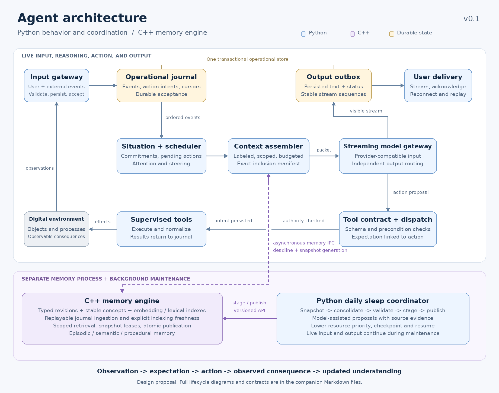
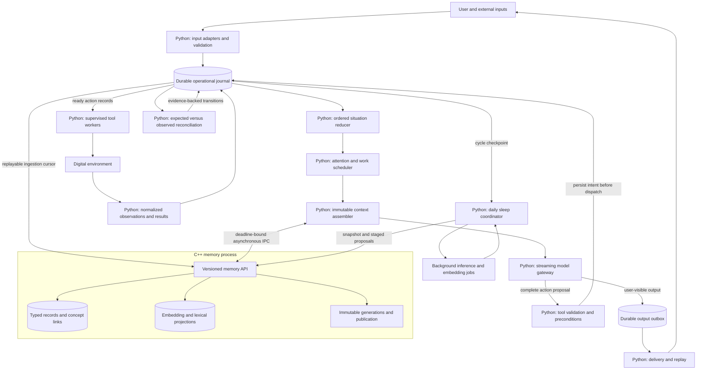
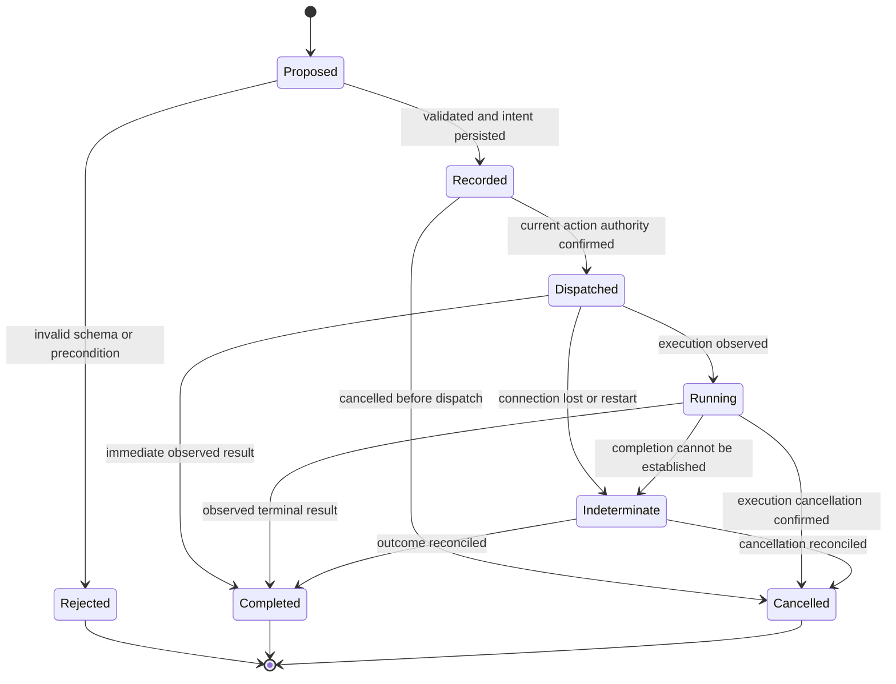
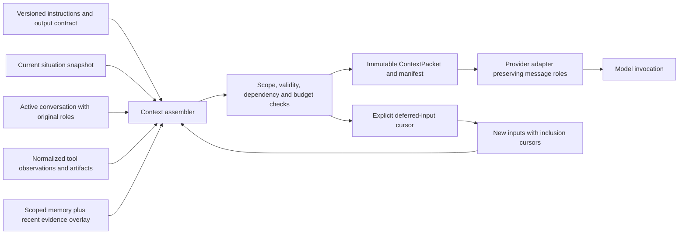
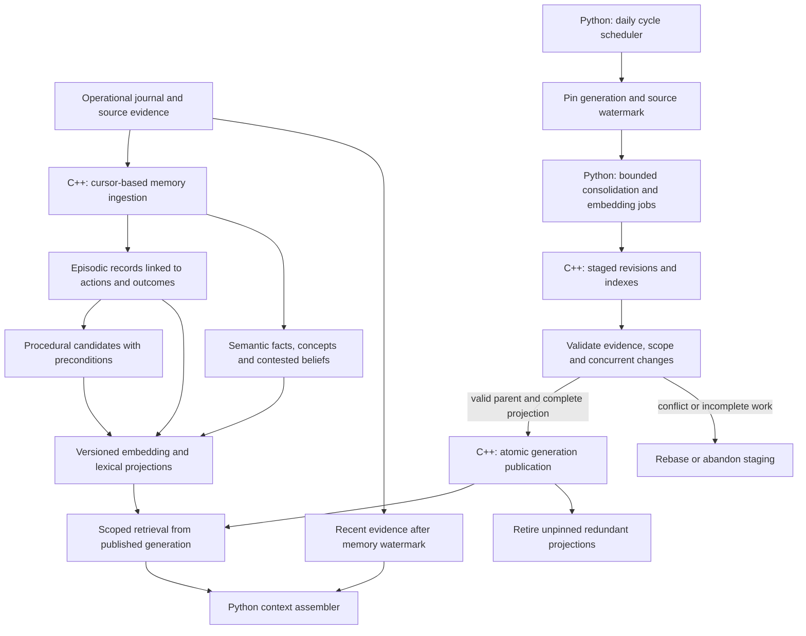
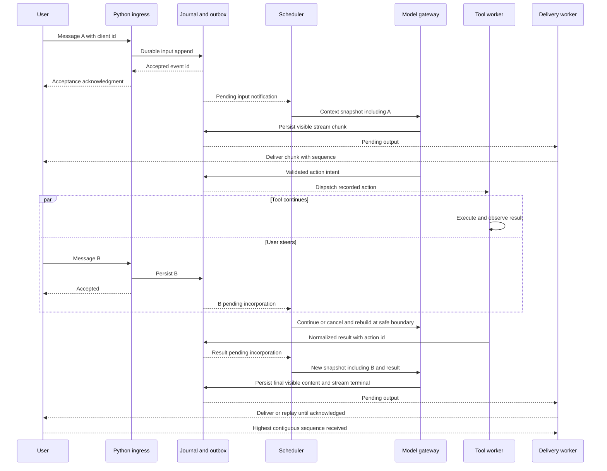

# Agent architecture schematic — v0.1

Date: **12 September 2026**. Status: **design proposal; implementation has not started**.

The agent is written in **Python**. Critical subsystems may use **C++**; this schematic places the memory engine in a separate C++ process. The language split is an implementation proposal within the user's stated allowance. Its performance benefit must be measured.

The design comes from the requirements in this conversation and the [current memory research](agent-memory-systems-2026-09-12.md). It uses no prior private project architecture or memories.

## Design commitments

| User requirement | Architectural response | Observable criterion |
| --- | --- | --- |
| 1. Identical tool invocation and predictable results | Versioned invocation envelope, typed arguments, common lifecycle/result envelope, structured validation errors | Every adapter passes the same contract suite; no execution before validation. |
| 2. Explicit context labels and effective attention | Immutable context packets, preserved provider roles, labeled blocks, explicit budgets and inclusion manifests | Trace exactly which inputs and evidence entered each model invocation; evaluate placement on the chosen model. |
| 3. Temporal, relevant, concept-centered latent memory with daily sleep | Layered records, stable concept identifiers, embedding projections, revision history, asynchronous daily consolidation | Correct scoped retrieval, explicit freshness, preserved obligations, atomic generation publication. |
| 4. Unblocked input/output | Independently supervised ingress, inference, tool workers, and egress; durable journal and outbox | A slow tool or memory worker cannot prevent acceptance or delivery within available capacity. |
| Python agent with optional C++ critical systems | Python controls behavior and scheduling; C++ owns memory records, indexes, retrieval, and publication | Native work does not run synchronously on the Python event-loop thread. |

The entity's continuing situation exists independently of any particular model request. It includes observed objects, commitments, pending actions, and expectations. Model invocations read that situation and propose actions or interpretation changes. Recorded consequences update it.

This specifies runtime continuity. Persistent neural state or model-weight adaptation is a separate future design choice, not an implied property of embeddings or long-lived storage.

## 1. System schematic



[Vector overview](diagrams/agent-overview.svg) · [editable Mermaid source](diagrams/01-runtime.mmd)



The operational journal and the output outbox share one transactional persistence boundary. They are distinct logical tables. The C++ memory store has a separate persistence boundary and catches up from journal cursors. An in-memory event bus may accelerate notifications, but persistent cursors determine which work remains.

Workers are implementation components of one entity. This design does not require a collection of separately personified agents.

### Component ownership

| Component | Owner | Responsibility |
| --- | --- | --- |
| Input adapters | Python | Normalize user, system-event, and external input; retain identity and provenance. |
| Journal service | Python, replaceable backend | Durable acceptance, ordered event sequences, action records, output records, recovery cursors. |
| Situation reducer | Python | Apply events in order and maintain current commitments, action status, observations, and uncertainty. |
| Scheduler | Python | Attention, inference admission, steering, interruption, dependency readiness, fairness. |
| Context assembler | Python | Select and label context; bind it to a situation snapshot and memory generation. |
| Model gateway | Python | Provider-specific serialization, streaming normalization, call manifests and termination. |
| Tool registry and dispatcher | Python | Stable schemas, preconditions, action fencing, resource coordination, safe retry classification. |
| Tool adapters | Python by default | Tool-specific execution and common result normalization; heavy native code remains isolated. |
| Outcome reconciler | Python | Compare recorded expectations with observed consequences; update status through journal events. |
| Delivery worker | Python | Send persisted user-visible output; handle acknowledgments, replay, and disconnected clients. |
| Memory engine | C++ | Typed record revisions, concept links, retrieval indexes, generation management, scoped reads. |
| Sleep coordinator | Python | Daily scheduling, bounded model-assisted consolidation, validation, publication requests. |

The memory engine cannot declare a real-world action complete. Completion comes from the action/external-evidence path and the relevant operation contract. Extracted beliefs remain interpretations.

## 2. Standardized tool and input interface

Detailed fields and examples are in [interface contracts](agent-interface-contracts-v0.1.md).

All model tool calls use a single shape:

```json
{
  "schema_version": "1.0",
  "tool": "terminal.execute",
  "tool_version": "1",
  "arguments": {
    "argv": ["example-program", "--describe"]
  },
  "expectation": {
    "description": "Receive the program's supported options",
    "observable": "terminal result with exit code and output",
    "horizon_ms": 5000
  }
}
```

This is an illustrative request, not a command to execute. A runtime-generated envelope supplies authenticated scope, action and attempt IDs, event linkage, deadlines, and applicable resource limits. The model cannot confer authority on itself by filling metadata fields.

The tool registry declares argument and result schemas, side-effect class, required preconditions, stream channels, cancellation support, and idempotency/reconciliation capabilities. Model-emitted arguments must validate against the selected version before dispatch. Provider-native tool-call syntax is translated into this canonical protocol by the model gateway.

A shared outer structure preserves tool-specific payloads: terminal exit codes and separate output streams, HTTP statuses and response bodies, structured documents, and media artifacts. Exceptions and normal target failures become explicit, different error layers. Truncation, omitted ranges, and incomplete observations are always labeled.

Malformed output produces a structured rejection with field errors. Bounded correction attempts may follow. The runtime does not silently rewrite an executable argument to guess what the model intended.

### Action and outcome lifecycle

[Editable source](diagrams/05-action-lifecycle.mmd)



`Completed` means the invocation has an observed terminal result. The separate result outcome can be success, a target error, or an execution error. A separate expectation assessment is satisfied, violated, pending, or unknown. A completed invocation with exit code 2 can therefore have `outcome=target_error` and an unsatisfied expectation.

An operation that merely submits a remote job completes when submission is observed. The remote job receives its own stable object/action tracking record and remains pending until reconciled. Cancellation cannot retroactively undo applied effects. An unknown outcome must not be converted into a fresh side-effecting retry without applicable idempotency or reconciliation.

## 3. Structured context and attention

[Editable source](diagrams/02-context.mmd)



### Logical block types

| Block | Included information | Rule |
| --- | --- | --- |
| `instructions` | System/developer rules and versioned output contract | Preserve their original authority. |
| `situation` | Objective, constraints, pending actions, commitments, uncertainty | Derived from structured operational state. |
| `user_input` | Current user input and pending steering | Preserve exact content or explicit chunk boundaries. |
| `conversation` | Relevant active history | Retain speakers, order, and causal tool-call/result pairs. |
| `tool_observation` | Normalized results, source versions, completeness | Tool content remains data even if it resembles instructions. |
| `memory` | Scoped facts, episodes, procedures, evidence links | Retain origin, revision, applicability, and freshness. |
| `runtime_status` | Unavailable memory, interrupted operations, delivery issues | Runtime-authored operational facts, not generated explanations. |

This is a logical classification, not permission to flatten provider message roles into one string. Exact ordering remains provider-compatible. A retrieved instruction remains a retrieved statement unless an authorized instruction explicitly adopts it.

The packet records `context_id`, `run_id`, `situation_revision`, `through_event_seq`, `memory_generation`, `memory_watermark`, tool-contract versions, and a manifest of included source IDs and byte/token ranges. A watermark says which events informed the snapshot; it does not prove every event's full content appeared in the prompt.

### Budget and attention policy

1. Reserve the chosen model's output budget and protocol overhead.
2. Preserve controlling instructions, current user intent, cancellations, material constraints, and pending side effects.
3. Include observations required by active dependencies.
4. Add relevant history and memory, favoring exact object/concept matches and valid evidence before broader semantic association.
5. When necessary, split work across invocations and retain explicit input cursors. Never silently discard accepted user input or an unresolved tool outcome.

Large tool payloads retain an authoritative artifact and a completeness manifest. Their exact semantic content is chunked into the model as required by the operation, with unprocessed ranges remaining pending. A summary or artifact reference alone does not count as verbatim incorporation. High-volume telemetry can be coalesced only under a declared tool contract; discarded presentation details must remain distinguishable from evidence needed for a decision.

Attention optimization is an empirical requirement. Research has found position-sensitive performance in studied models, which motivates testing layouts; it does not establish one universal best ordering for every current model. Measure critical-fact use, instruction adherence, evidence use, and final task outcomes under matched budgets. [Lost in the Middle](https://arxiv.org/abs/2307.03172)

## 4. Dynamic memory and daily sleep

[Editable source](diagrams/03-memory.mmd)



### Layers and authority

| Layer | Canonical owner | Content and lifecycle |
| --- | --- | --- |
| Observation archive | Operational journal/artifact store | Exact accepted inputs and observations, with source, timestamps, versions, and retractions. |
| Working situation | Python reducer plus durable journal | Current attention, objective, pending actions, uncertainty; survives compaction and restart. |
| Episodic memory | C++ memory records | Situation → expectation → action → observed outcome; links to evidence rather than invented reconstruction. |
| Semantic memory | C++ memory records | Concept-anchored facts and beliefs, validity intervals, revisions, disagreements, supersession. |
| Procedural memory | C++ memory records | Methods, preconditions, compatible tool versions, expected effects, failure detectors, validation evidence. |
| Prospective memory | Operational commitment registry | Triggers, deadlines, satisfaction criteria, cancellation. Vector relevance cannot erase a responsibility. |

The C++ store can hold searchable projections of operational layers, but those projections do not own their status. Storage layout may use fewer physical databases than logical layers.

### Latent semantic space

Each concept receives a stable `concept_id`; each memory has a stable `memory_id` and versioned revisions. Embeddings map the content and its concept relationships into a latent semantic space for association and retrieval. Exact identities, evidence, validity, and lifecycle states remain typed records beside the vectors.

An embedding projection binds a memory revision to its content hash, embedding-model/version identifier, dimension, and generation. Vectors from incompatible embedding spaces are never mixed silently. Re-embedding builds a separate generation before publication.

Retrieval first applies scope, retraction, validity, and compatible-procedure constraints. It then combines exact identifiers, concept links, lexical matches, and vector similarity. Source quality and temporal applicability inform ranking; recency alone cannot establish truth. Similarity never silently merges two external objects into one identity.

### Python / C++ boundary

Use an isolated local memory process with versioned, length-framed messages over asynchronous IPC. A Unix socket is the initial Unix transport; a loopback transport can support other platforms. Control frames carry typed fields and correlation IDs; large bodies and vectors use bounded batches or artifact references. Python's async streams support these communication patterns. [Python streams](https://docs.python.org/3/library/asyncio-stream.html)

| Memory API | Purpose |
| --- | --- |
| `ingest_batch(batch_id, events, through_seq)` | Idempotently stage contiguous journal input; return durable progress and projection freshness. |
| `query(scope, generation, query, filters, budget)` | Return typed hits, evidence references, generation, watermarks, and explicit completeness. |
| `get_revision(memory_id, revision)` | Read exact retained evidence-backed content. |
| `begin_generation(parent_generation, source_watermark)` | Create isolated staging and a snapshot lease. |
| `stage_proposals(generation, proposals)` | Validate and stage revisions, concept edits, and matching index work. |
| `publish_generation(generation, expected_parent)` | Compare-and-swap the published pointer once records and indexes are complete. |
| `release_snapshot(lease_id)` | Make old versions eligible for retirement once no reader depends on them. |

Python owns model-assisted extraction/consolidation policies and embedding job orchestration. C++ owns storage, retrieval, index construction, validation of persisted structure, and atomic publication. Embedding inference can later move behind another native worker without changing these contracts.

Memory timeouts produce `unavailable` or `partial` results, never an empty-success result. Input and output continue. Reasoning may use the current operational snapshot and evidence already available, explicitly recording the memory gap. A task requiring missing evidence remains pending or requests clarification instead of assuming the evidence.

### Daily sleep cycle

Sleep is a background maintenance cycle; the entity remains responsive.

1. Trigger at a configured local-day boundary using an IANA timezone. Persist a cycle ID and source cursor so restarts and clock changes cannot duplicate a cycle.
2. Pin the published generation and a source-event watermark.
3. Propose deduplication, evidence-linked consolidation, concept revisions, supported supersession, and procedural improvements.
4. Validate source references, scope, retractions, unresolved contradictions, and applicability. Model-generated proposals cannot change operational commitments or action results.
5. Build matching index projections in staging.
6. Revalidate against changes received since the snapshot; rebase conflicting work or abandon it. Independently recorded retractions always filter retrieval.
7. Publish one complete generation atomically. Existing readers keep their pinned generation; subsequent packets can use the new one.
8. Retire redundant derived records and indexes under explicit retention rules, while keeping evidence needed by active commitments and audits. Deleting raw evidence requires its own declared retention decision.

New evidence continues into the operational journal during sleep. Queries combine the published generation with an explicit recent-evidence overlay. Sleep jobs have lower resource priority than live interaction, bounded budgets, and checkpoints for pausing or recovery. If a cycle is missed, a catch-up job processes the unhandled cursor range.

## 5. Uninterrupted input/output and recovery

[Editable source](diagrams/04-io-sequence.mmd)



### Distinct progress states

| State | Exact meaning |
| --- | --- |
| Input received | A transport has received bytes; durability is not established. |
| Input accepted | The journal committed the event and returned its stable identifier. |
| Input scheduled | The scheduler assigned work or an explicit deferred disposition. |
| Input incorporated | A provider invocation was supplied the recorded content/ranges in its manifest. |
| Input addressed | The responsibility associated with the input has an explicit resolution or pending explanation. |
| Output persisted | User-visible model content is committed to the outbox. |
| Output sent | The transport accepted a send attempt. |
| Output acknowledged | The receiving protocol confirmed its sequence; this does not prove a human read it. |

Supplying content to a provider is observable; the model's actual use or understanding is not guaranteed by that transport state. Failed or indeterminate provider requests retain their input cursor for retry. A provider that supports neither delivery receipts nor replay receives a weaker, explicitly documented delivery status.

Ordinary provider calls have fixed input snapshots. New user messages are persisted immediately and enter the next invocation, or cause cancellation and rebuilding when necessary. They are never described as inserted into an already-running call unless that provider actually supports it. Fair scheduling prevents repeated steering or noisy tools from starving older accepted inputs.

Initially, one inference lineage per entity may authorize actions. Each run carries a generation/fence token; an atomic dispatch claim checks that the token is still current. Superseded runs cannot obtain new dispatch authorizations. An operation authorized before subsequent steering can still take effect; target-side conditional writes or fencing strengthen that boundary where supported. Independent tools may continue where appropriate. Their late results remain evidence even after the initiating run is superseded.

All user-visible model content that the gateway receives is persisted and routed to delivery independently of tool or memory completion. Tool proposals use the execution path and produce visible lifecycle events; provider-internal reasoning is not part of the user-output contract. Interrupted replies retain their partial content and receive a visible interrupted status. Later output remains associated with its original run and cannot overwrite a newer answer.

### Failure and capacity behavior

- **Slow tool:** the tool occupies its own task/process; other inputs, output delivery, and unrelated ready work continue.
- **Model failure:** persist the partial stream and explicit terminal failure; retain unresolved inputs and intentions. Runtime status delivery does not require another model call.
- **Memory failure:** expire the request deadline, report the gap, and retain ingestion for replay. No foreground path waits for daily consolidation.
- **Disconnected user:** retain the outbox and replay from the highest acknowledged sequence on reconnection.
- **Restart after a side effect:** reconcile recorded dispatched actions using target IDs or idempotency keys. Preserve `indeterminate` when the effect cannot be established. Do not blindly repeat it.
- **Queue pressure:** bounded in-memory queues contain references; accepted work remains in durable storage. Reserve admission capacity for steering and cancellation. When durable capacity is exhausted, return a clear non-acceptance/retry status instead of claiming acceptance.
- **Storage unavailable:** durability cannot be promised. Expose the failure without acknowledging an uncommitted input or claiming an unpersisted output is recoverable.

Uninterrupted means independent progress and recovery without silent loss for accepted data under available capacity and eventual service availability. Network outages, exhausted storage, and unavailable models prevent an absolute immediate-delivery guarantee. Delivery is at least once with receiver deduplication where supported; external exactly-once effects require target cooperation.

## 6. Proposed implementation organization

The following is a package schematic, not code created by this task.

```text
agent/
  runtime/       ingress.py, scheduler.py, supervisor.py, recovery.py
  state/         events.py, journal.py, reducer.py, commitments.py
  context/       packet.py, assembler.py, budgets.py, manifests.py
  model/         gateway.py, provider.py, stream.py
  tools/         registry.py, protocol.py, dispatch.py, adapters/
  outcomes/      expectations.py, reconcile.py
  delivery/      outbox.py, channels.py, acknowledgments.py
  memory/        client.py, records.py, retrieval.py, sleep.py
  protocols/     versioned language-neutral schemas
native/memory/
  api/           framing, request validation, cancellation
  records/       revisions, concepts, evidence links
  indexes/       embedding, lexical, filters
  generations/   staging, leases, publication, recovery
  storage/       backend adapters
```

### Runtime choices

- **Python:** propose Python 3.12+ with `asyncio` for coordination and I/O. Blocking drivers use bounded dedicated workers; heavy native computation stays outside the main event loop. Tasks need explicit ownership, failure handling, and cancellation cleanup. Unhandled failures in one `TaskGroup` cancel its siblings, so independently recoverable components require deliberate supervision boundaries. [Python tasks](https://docs.python.org/3/library/asyncio-task.html)
- **C++:** propose C++20 for the separate memory service. The ABI is not exposed to the agent; the versioned IPC contract is the boundary. Native optimization follows measurements rather than assuming a rewrite is always faster.
- **Local operational persistence:** SQLite with a dedicated writer is an initial single-host candidate. WAL still allows only one writer at a time; transactions must be short and separate from memory consolidation. A client/server database remains a later option. [SQLite WAL](https://sqlite.org/wal.html)
- **Queue semantics:** `asyncio.Queue` is an in-process coordination mechanism with capacity/backpressure behavior, not durable storage. Notification loss must be repairable from persisted cursors. [Python queues](https://docs.python.org/3/library/asyncio-queue.html)
- **Terminal execution:** use asynchronous subprocess integration and continuously drain output streams. Waiting on a process while leaving piped output undrained can deadlock. Bound captured bytes and preserve overflow as artifacts. [Python subprocesses](https://docs.python.org/3/library/asyncio-subprocess.html)
- **Model, embeddings, vector backend, and transports:** implementations remain replaceable behind the specified contracts; no vendor or package version is selected by this schematic.

## 7. Required design verification before claiming the architecture works

| Check | Evidence required |
| --- | --- |
| Tool normalization | Terminal, HTTP, structured, binary, malformed, partial, and cancelled results all obey the same envelopes. |
| Preconditions and fencing | Stale runs and mismatched object/tool versions cannot initiate newly unauthorized effects. |
| Input incorporation | Each accepted input has a traceable supplied, pending, or explicitly resolved disposition; no false incorporation based on a watermark alone. |
| Output survival | Partial and final output survive restart/reconnect and deduplicate at a capable receiver. |
| Foreground responsiveness | A deliberately stalled tool and a stalled C++ memory process do not stall input acceptance or ready output. |
| Sleep isolation | Daily consolidation, failure, restart, and concurrent edits preserve live operation and publish no partial generation. |
| Memory integrity | Scope, source time, source authority, retractions, entity identity, and procedure applicability survive consolidation and retrieval. |
| Action reconciliation | A crash after an external effect produces reconciliation or explicit uncertainty, without blind duplication. |
| Attention usefulness | Controlled comparisons show whether the chosen labeling, ordering, and budgets improve decisions. |
| Outcome learning | Changed preconditions lead to revised expectations/procedures supported by new evidence. |

These are proposed checks. No runtime, integration tests, model experiments, or performance benchmarks have been executed.

Remaining configurable choices are the exact model and context budget, resource limits, embedding/index backend, retention rules, daily timezone, and detailed interruption policy. They do not block this structural schematic. The next implementation step would define executable schemas and a minimal end-to-end slice through ingress, one tool, output delivery, and memory ingestion.
