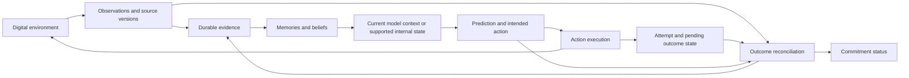

# Current memory systems for agents

Research date: **12 September 2026**. Public sources were accessed on this date.

This report supports a new agent architecture being developed from scratch. Its starting requirements come only from the present conversation: consistency in the agent's reality, stability in its actions, and understandable expected outcomes. Prior project memories and implementations were excluded from the research.

This is a representative architectural survey, not an exhaustive catalogue or an implementation recommendation. Findings come from official documentation, maintainer repositories, and original papers. No systems were installed, benchmarked, or exercised against live tasks. Current documentation is mutable; differences between current and older designs are identified below.

**Evidence language:** “Documented” describes a mechanism in the cited primary source. “Reported” describes an author's or vendor's evaluation result. “Interpretation” and “proposed” identify analysis for this design exercise. An undocumented property is unknown, rather than proof that a product lacks it.

## Findings that matter for this architecture

Agent memory already covers substantially more than saving a transcript. The surveyed systems include versioned files, background consolidation, temporal graphs, inferred user models, procedural knowledge, and persistent execution state. A new design should account for that breadth rather than assume every existing system is a vector database around a chat loop. The product sections below supply the supporting sources.

**Interpretation:** The central design distinction for our discussion is between an observed event, a remembered account of that event, a belief derived from it, and the operational state of an unfinished action. Each can be useful and durable, but they have different correctness conditions. A memory saying that a report was submitted does not establish that the receiving application accepted it.

We should evaluate memory as part of the entity's interaction with its environment: whether it preserves relevant distinctions, handles change, and helps the entity make reliable predictions. Retrieval accuracy is one component of that evaluation.

## 1. A vocabulary that separates different mechanisms

The following categories are an analytical vocabulary for this report. A system may implement several, and its own terminology may differ. LangChain's documentation explicitly separates thread state, cross-thread stores, semantic facts, episodic experience, and procedural instructions. [LangChain memory concepts](https://docs.langchain.com/oss/python/concepts/memory)

| Memory or state category | What it carries | Question it helps answer | Important boundary |
| --- | --- | --- | --- |
| Working context | Information available to the current inference | What matters to the next decision? | Material outside context may still exist in storage. |
| Transcript or episode history | Messages, observations, actions, and results | What was observed or attempted? | A recorded assertion can be false; a partial log can omit consequences. |
| Semantic memory | Facts, relationships, preferences, and generalizations | What do I currently believe? | Beliefs need provenance, scope, and revision rules. |
| Procedural memory | Instructions, examples, scripts, or reusable policies | How should I approach this kind of situation? | A successful example does not establish universal applicability. |
| Prospective memory | Commitments and conditions for future action | What must I remember to do? | Storage alone does not implement triggering or cancellation. |
| Execution state | Pending work, identifiers, checkpoints, acknowledgments | What is actually in progress? | This should be reconciled with the executing system. |
| Environmental state | Objects, versions, resources, and available operations | What currently exists and what can be changed? | An agent may have only partial, delayed access to it. |
| Learned internal memory | Model-supported recurrent state or learned parameters | What computational state or behavior carries forward? | This requires model mechanisms beyond an external notes store. |

Semantic search is a retrieval technique; semantic memory names a kind of retained knowledge. A graph is a representation choice; it does not inherently make its contents true. Checkpoint persistence concerns execution state; it does not by itself validate external effects. These distinctions should remain explicit in any schematic.

## 2. Memory inside agent runtimes

### OpenClaw

**Documented:** Current OpenClaw uses workspace files plus SQLite indexing, with separate curated, episodic, prospective, and review surfaces. Background “dreaming” stages and consolidates candidate memories. Provenance classes and supersession metadata affect promotion and recall. Retrieval includes ordinary search and a deeper recall agent for eligible requests. These are meaningful curation and lifecycle mechanisms beyond plain transcript storage. [Memory architecture](https://docs.openclaw.ai/concepts/memory-architecture)

**Documented:** Standing intents persist event-conditioned instructions with scope, expiry, cooldown, fire limits, and explicit cancellation. The dedicated guide describes deterministic matching before eligible interactive replies. Its `done` state means the fire budget is exhausted; it should not be read as evidence that an external objective was accomplished. [Standing intents](https://docs.openclaw.ai/concepts/standing-intents)

**Limitation:** The deletion documentation distinguishes tracked ingestion-derived memories from other retained files and copies. Forgetting an indexed memory is therefore a scoped operation, not a universal erasure guarantee. [Provenance and deletion](https://docs.openclaw.ai/concepts/memory-provenance)

**Interpretation:** Useful precedents are provenance-aware consolidation and explicit future-intent state. The memory architecture still describes external representations used by model invocations; it does not establish persistent learned internal model state.

### Hermes Agent

**Documented:** Native memory uses two bounded files for agent notes and user information. Their prompt copies are frozen at session start. The agent can add, replace, or remove entries; capacity overflow requires explicit curation. The feature guide describes SQLite FTS5 session search returning stored messages and post-turn background review that can update memory or skills. Memory is scoped by profile, and the docs warn against concurrent agents sharing one Hermes home. [Persistent memory](https://hermes-agent.nousresearch.com/docs/user-guide/features/memory)

**Documented:** Skills provide reusable instructions and supporting resources, with selective loading and management tools. [Skills system](https://hermes-agent.nousresearch.com/docs/user-guide/features/skills)

**Interpretation:** Hermes distinguishes compact contextual knowledge from reusable procedures. Saving a lesson or skill can change future prompted behavior; it is not evidence of model-weight learning or a verified causal model of an environment.

**Source discrepancy:** The overview still mentions session-search summarization, while the specific memory guide says results are actual database messages without LLM summarization. This report follows the more specific feature guide; a chosen release would need source-level verification. [Hermes overview](https://hermes-agent.nousresearch.com/docs/)

### Pi

**Documented:** Pi's session format is a JSONL tree with stable entry identifiers and parent links. It records messages, tool results, model changes, compaction entries, and branch summaries. Current documentation resides at Pi's own site following the project's move to Earendil. [Session format](https://pi.dev/docs/latest/session-format), [project move](https://pi.dev/news/2026/5/7/pi-has-a-new-home)

**Documented:** Compaction summarizes older context while retaining recent material; branch summarization preserves selected context when navigating the session tree. These mechanisms manage the context delivered to inference. [Compaction and branch summarization](https://pi.dev/docs/latest/compaction)

The separately published `pi-observational-memory` extension describes incremental observations and reflections prepared before compaction. It is an extension, not evidence that every Pi installation has that mechanism. [Extension's published description](https://pi.dev/packages/pi-observational-memory)

**Interpretation:** Session lineage is valuable for reconstructing how a decision developed. A branch in conversation history does not automatically branch, roll back, or isolate external reality.

### Grok Bot

**Documented:** Bots retain role-specific working preferences, facts, and summaries, and exchange context through messages, group conversations, and shared files. Current operational documentation explicitly directs users to keep changing facts in source systems. Duplicating a Bot does not copy its learned memory or conversation history. [Bot management and memory](https://docs.x.ai/grok-bot/bots)

**Unknown from reviewed public sources:** The exact memory extraction algorithm, storage schema, retrieval ranking, conflict-resolution algorithm, and neural-state persistence.

**Version/source caution:** The September 3 design article describes each Bot as having its own computer; the September 7 operational guide states that Bots share a computer. This report follows the later operational guide for that boundary and makes no claim about backend isolation. [Design article](https://x.ai/news/designing-grok-bot), [operational guide](https://docs.x.ai/grok-bot/bots)

**Interpretation:** Persistent responsibility and collaboration are documented product properties. They do not disclose the internal memory implementation or establish continuous learned cognition.

## 3. Framework mechanisms for continuity

### LangGraph: execution checkpoints and cross-thread memory

**Documented:** LangGraph checkpoints graph state so execution can be resumed and inspected. Its separate Store interface carries information across threads in custom namespaces. Storage implementations can provide durable backing and optional semantic search. [Persistence](https://docs.langchain.com/oss/python/langgraph/persistence)

Its conceptual guide describes facts, episodes, and procedural instructions, with writes either during execution or in background work. These are building blocks whose policy remains partly application-defined. [Memory concepts](https://docs.langchain.com/oss/python/concepts/memory)

**Interpretation:** This is an important counterexample to treating all agent state as chat text. An implementation can carry structured operational state. It must still define how a restored checkpoint relates to an external action that may already have happened, how competing writes resolve, and how observations supersede beliefs.

### Mastra: observational memory

**Documented:** Mastra's Observer and Reflector maintain a compressed observation log as conversation history grows. The current guide describes background buffering, activation conditions, stored history, and resource/thread identities. Observations become context for the acting agent. [Observational memory](https://mastra.ai/docs/memory/observational-memory)

Current extractors can persist structured values alongside observations, including application-defined schemas. [Memory extractors](https://mastra.ai/blog/introducing-memory-extractors)

**Interpretation:** Preparing memory incrementally can reduce dependence on a single compaction event. Structured extraction can preserve values that prose summaries obscure. Both remain subject to extraction errors and to the freshness of their inputs.

**Evidence limit:** Marketing phrases about eliminating context degradation and vendor benchmark headlines are not guarantees of lossless memory or stable action outcomes. This report does not adopt those claims as measured facts about our use case.

## 4. Dedicated memory frameworks and services

### Letta: current MemFS and legacy MemGPT-style memory

**Documented current design:** MemFS is an agent-owned Git repository projected into its runtime. Markdown under `system/` enters the prompt; other files are read on demand. The directory tree guides retrieval. Semantic indexing is optional rather than intrinsic. Git commits and synchronization distinguish durable repository content from local edits. [MemFS](https://docs.letta.com/concepts/memfs)

Background dreaming examines interactions and updates memory or skills, with configurable triggers and an optional further review. [Memory and dreaming](https://docs.letta.com/configuration/memory)

Organization-owned shared memory repositories can be attached to multiple cloud agents. They use push/pull synchronization and differ from older shared memory blocks. [Shared memory](https://docs.letta.com/concepts/shared-memory)

**Legacy boundary:** The V1 SDK separately documents database-persisted agents, pinned mutable memory blocks, and archival semantic search. Describing Letta exclusively as core blocks plus an archival vector store misses the current MemFS path. [V1 stateful agents](https://docs.letta.com/v1-sdk/concepts/stateful-agents), [V1 archival memory](https://docs.letta.com/v1-sdk/memory/archival-memory)

**Interpretation:** Versioned memory gives useful edit provenance and recovery. A clean Git merge does not decide which factual claim is true, and deleting a current file does not automatically erase its history. Dreaming changes external knowledge and procedures; the reviewed mechanisms do not establish online learning of the acting model's parameters.

### Mem0: distinguish Platform V3, Dream, and OSS

**Documented current Platform ingestion:** V3 extracts records with an ADD-only path, replacing the older extraction-plus-UPDATE/DELETE description. It can retain assistant statements as well as user statements. Ingestion is asynchronous; acceptance precedes completion. [V3 migration](https://docs.mem0.ai/migration/platform-v2-to-v3)

**Documented revision:** Dream supplies Supersede and Merge during ingestion, plus opt-in scheduled Synthesis. Superseded records remain available by default; `latest_only=true` filters them. Merged duplicates are hidden by default but can be requested. Synthesis has additional eligibility conditions, including user-only scope, post-enablement data, a minimum corpus, and plan-dependent scheduling. Thus ADD-only extraction does not mean there is no correction mechanism. [Dream](https://docs.mem0.ai/platform/features/dream)

**Documented graph boundary:** Current Platform graph memory links entities to memories mentioning them. It is co-occurrence connectivity rather than typed entity-to-entity relationships. It should not be treated as equivalent to Graphiti's temporal relationship graph. [Graph memory](https://docs.mem0.ai/platform/features/graph-memory)

Scope and special memory types differ across products. The documented special procedural-memory path is Python OSS-specific and requires agent scope; it is not the same feature set as Platform. The generic memory-types page retains older extraction language, so the V3 migration governs the Platform description here. [Memory types](https://docs.mem0.ai/core-concepts/memory-types)

Expiration hides records from normal retrieval but can leave direct-ID access; explicit deletion is a separate operation. Self-hosting also requires configured models and storage. [Add and expiration](https://docs.mem0.ai/core-concepts/memory-operations/add), [deletion](https://docs.mem0.ai/core-concepts/memory-operations/delete), [OSS deployment](https://docs.mem0.ai/open-source/overview)

**Interpretation:** Scope filters, visibility rules, and ingestion completion must be explicit in an integration. Extracted assistant claims need to remain distinguishable from externally verified results.

### Zep and Graphiti: temporal relationships and episode provenance

**Documented:** Graphiti ingests episodes containing messages, text, or structured data, then extracts entities and relationships while retaining links to source episodes. Its temporal representation distinguishes when a fact applies from when it is recorded or marked invalid by the system. Relationship history can remain available after invalidation. [Episodes](https://help.getzep.com/graphiti/core-concepts/adding-episodes), [temporal fields in the implementation](https://raw.githubusercontent.com/getzep/graphiti/main/graphiti_core/edges.py)

Retrieval combines graph, text, semantic, and temporal mechanisms. Graphiti is an open-source framework; managed Zep has its own product implementation, so deployment and feature parity should not be assumed. [Graphiti overview](https://help.getzep.com/graphiti/getting-started/overview)

**Operational caveat:** The documented bulk ingestion path does not invalidate contradictory edges. Its suitability therefore depends on whether the graph is initially empty or invalidation is unnecessary. [Bulk ingestion boundary](https://help.getzep.com/graphiti/core-concepts/adding-episodes)

Graph groups provide namespaces; deletion and temporal invalidation are separate operations. Applications must still enforce the intended access boundaries. [Namespacing](https://help.getzep.com/graphiti/core-concepts/graph-namespacing), [CRUD](https://help.getzep.com/graphiti/working-with-data/crud-operations)

**Interpretation:** Temporal facts and retained evidence are directly relevant to changing reality. Extraction can still misidentify entities or choose the wrong interpretation of a contradiction. A temporal knowledge graph records a model of events; it does not independently determine the authoritative state of an external process.

## 5. Systems emphasizing experience, perspectives, and consolidation

### Hindsight

**Documented:** Hindsight organizes persistent memory into banks with an agent perspective. Retention distinguishes the agent's own experiences from facts about outside entities. It extracts entities and connections across semantic, temporal, and reported causal relationships. Event time and the time information was learned can differ. The documentation acknowledges entity-resolution errors. [Retention](https://hindsight.vectorize.io/developer/retain)

Recall combines several retrieval methods. Reflection reasons over retained material under the bank's configuration. [Architecture](https://hindsight.vectorize.io/)

Consolidated observations connect synthesized beliefs to evidence. New information can revise them, and freshness tracking distinguishes recently retained evidence from consolidated understanding. Maintained “mental models” answer selected questions and can be refreshed with evidence and version history. [Observations](https://hindsight.vectorize.io/developer/observations), [mental models](https://hindsight.vectorize.io/developer/mental-models)

**Interpretation:** Perspective, evidence-linked revision, and freshness are valuable precedents. Source counts are not calibrated probabilities, reported causal relationships are not automatically established causes, and maintained explanatory documents are not executable environmental dynamics. The reviewed interfaces influence subsequent reasoning through external memory.

### Honcho v3

**Documented:** Honcho asynchronously derives premises, conclusions, summaries, and representations from interactions. Applications request stored representations or query-specific reasoning. Its use of models trained for these operations does not imply that the acting agent updates its own weights during a session. [Reasoning architecture](https://honcho.dev/docs/v3/documentation/core-concepts/reasoning)

A particularly relevant mechanism is directional representation: a collection is scoped to a workspace, observer, and observed peer. An actor's knowledge of another actor can reflect only interactions available to that observer. Adding an observer later does not retroactively process all earlier interactions for it. [Directional representations](https://honcho.dev/docs/v3/documentation/features/advanced/directional-representations)

Experimental Dreaming revisits conclusions, resolves some contradictions, and derives patterns under explicit scheduling and eligibility conditions. Consolidation can lag new evidence. [Dreaming](https://honcho.dev/docs/v3/documentation/features/advanced/dreaming)

**Interpretation:** This offers a concrete alternative to an omniscient shared memory. We should preserve the distinction between what exists, what an actor observed, and what it inferred. Generated deductions still require assessment; labeling a conclusion deductive does not guarantee that its premises or reasoning are correct.

### OpenViking

**Documented:** OpenViking exposes resources, memories, and skills through a virtual filesystem. Current memory namespaces are user- or peer-scoped. The context-types guide lists active personal, entity, event, identity, case, trajectory, and experience categories. Schema-defined memory types for tools and skills are disabled; standalone `SKILL.md` capabilities remain supported. Older category lists should not be treated as current enabled functionality. [Context types](https://github.com/volcengine/OpenViking/blob/main/docs/en/concepts/02-context-types.md)

Session commit first archives messages, then performs summarization and memory extraction asynchronously. A memory diff records created, merged, deleted, and skipped changes. Retrieval can navigate a hierarchy and use session-aware query planning and reranking. [Session lifecycle](https://github.com/volcengine/OpenViking/blob/main/docs/en/concepts/08-session.md), [retrieval](https://github.com/volcengine/OpenViking/blob/main/docs/en/concepts/07-retrieval.md)

**Interpretation:** Navigable context and inspectable experience updates are useful. Archive acceptance and completion of extracted memory have different meanings. A stored trajectory can support later decisions without supplying transactional guarantees for the actions it describes.

### EverOS, formerly EverMemOS

**Documented current product:** The former EverMemOS repository redirects to EverOS. Its current architecture uses canonical Markdown, SQLite system state, and retrieval indexes. It separates user episodes/profiles from agent cases/skills and supports several retrieval scopes. [Current repository](https://github.com/EverMind-AI/EverOS)

Message boundaries or explicit flushes produce episode records; asynchronous processing derives facts, profiles, cases, and skills. Edited Markdown is queued for reindexing. Optional reflection merges episode clusters and marks older records as deprecated. Durable writing and searchable availability therefore have separate completion points. [Memory pipeline](https://github.com/EverMind-AI/EverOS/blob/main/docs/how-memory-works.md)

**Interpretation:** Portable canonical records and derived procedures are useful design references. The current system retains some MemCell terminology, so the name change should not be read as total abandonment of earlier ideas. Case and skill extraction changes external resources; its presence alone does not demonstrate a verified increase in competence or a general method for resolving conflicting authorities.

## 6. Comparison by architectural role

This table summarizes the documented mechanisms above. “Additional work” identifies a requirement for an integration or an evaluation question, rather than claiming a product cannot support it.

| System | Most relevant documented mechanism | Additional work for our stated requirements |
| --- | --- | --- |
| OpenClaw | Curated/episodic tiers, provenance, standing intents | Connect trigger and memory states to observed external outcomes. |
| Hermes | Bounded notes, session recall, reusable skills | Track current operational state separately from session-start notes. |
| Pi | Session lineage, compaction, extension points | Preserve external object identity and effects across context branches. |
| Grok Bot | Persistent role context and collaboration | Establish memory internals and consistency contracts through further evidence. |
| LangGraph | Execution checkpoints and namespaced stores | Reconcile restored state with external effects and concurrency. |
| Mastra | Incremental observations and structured extraction | Measure lost distinctions and freshness under consolidation. |
| Letta | Versioned files, shared repositories, dreaming | Resolve factual conflicts and distinguish local from synchronized state. |
| Mem0 | Extracted records, scope filters, lifecycle processing | Make read visibility and verification of source assertions explicit. |
| Zep / Graphiti | Temporal relationships with episode provenance | Preserve authority and handle erroneous extraction or entity merging. |
| Hindsight | Experience/world distinction and evidence-linked beliefs | Link beliefs to measured outcomes and test calibration. |
| Honcho | Observer-specific representations | Keep perspective, observation access, and actual world state distinct. |
| OpenViking | Hierarchical context and inspectable experience extraction | Reconcile archived, extracted, and searchable versions. |
| EverOS | Portable records and derived cases/skills | Validate applicability and react to changed action preconditions. |

## 7. What the benchmarks establish

### Conversational and incremental memory

**LongMemEval** tests extraction, cross-session reasoning, temporal reasoning, updates, and abstention through 500 questions. Its decomposition into indexing, retrieval, and reading helps locate failures. These are useful memory tests; answering questions over history does not certify recovery of an interrupted real-world action. [Original paper](https://arxiv.org/abs/2410.10813)

**LoCoMo** evaluates long conversational memory through question answering, event summarization, and multimodal dialogue generation. The authors' current selected release contains ten conversations. Older arXiv and ACL descriptions differ in aggregate conversation lengths and session counts, so comparisons should name the release rather than repeat a universal corpus size. [ACL paper](https://aclanthology.org/2024.acl-long.747/), [official dataset](https://github.com/snap-research/locomo)

**MemoryAgentBench** incrementally presents information and tests retrieval, learning from supplied examples, long-range understanding, and selective forgetting. The inspected v4 specifies that newer conflicting facts, identified by larger serial numbers, should prevail. Applying that rule is different from determining which of several conflicting real-world sources is authoritative. Correct answer revision also does not establish complete data erasure. [Paper v4](https://arxiv.org/html/2507.05257v4), [official implementation](https://github.com/HUST-AI-HYZ/MemoryAgentBench)

### Environment experience and memory-guided action

**LongMemEval-V2**, published in May 2026, directly tests experience in an environment: static recall, dynamic state tracking, workflow knowledge, environmental gotchas, and premise awareness. Its 451 questions use web-agent trajectories. Memory is inserted and queried, and a fixed reader answers from a bounded evidence context. This moves closer to our requirements, while the main measurement remains evidence gathering followed by QA. [Paper](https://arxiv.org/abs/2605.12493), [authors' project](https://xiaowu0162.github.io/longmemeval-v2/)

**MemoryArena**, published in February 2026, couples memory with actions and feedback across interdependent sessions. Domains include web navigation, constrained planning, search, and formal reasoning. It is a direct counterexample to the claim that all memory evaluation is static conversational recall. Its task results still do not automatically establish arbitrary-duration continuity, crash recovery, or calibrated action predictions; those need targeted tests. The code is described as a preview under active maintenance. [Paper](https://arxiv.org/abs/2602.16313), [official implementation](https://github.com/ZexueHe/MemoryArena)

**EMemBench** generates verifiable questions from an agent's own interactive game trajectories. It is useful further reading for experience-specific evaluation. [Paper](https://arxiv.org/abs/2601.16690)

### Experience can change behavior without changing base-model weights

**Reflexion** retains feedback-derived reflective text that influences later attempts, without updating model weights. Its mechanism is a precedent for behavioral adaptation through episodic memory. Reflection can be useful while still containing an incorrect explanation of why an attempt failed. [Reflexion](https://arxiv.org/abs/2303.11366)

**Voyager** develops and retrieves executable skills in Minecraft using environment feedback, errors, and verification, through black-box model calls. It demonstrates that external memory can contain reusable behavior. Its results do not by themselves transfer to arbitrary digital environments. [Voyager paper](https://arxiv.org/abs/2305.16291), [authors' project](https://voyager.minedojo.org/)

**Titans** explores a different level: a neural memory module whose parameters update while processing inputs, alongside attention. This differs from retrieving external notes. Its associative-loss-based surprise is not automatically the prediction error of an action in a digital environment. External records, recurrent hidden state, adaptive memory-module parameters, and updates to a base model should remain separate design choices. [Titans mechanism](https://arxiv.org/html/2501.00663v1)

### How to interpret published scores

Do not construct a product leaderboard by combining headline scores from these sources. Compare the exact dataset/version, reader and extraction models, memory budget, retrieval budget, write policy, judge, and scoring procedure. Include ingestion, consolidation, and storage costs as well as query latency. Distinguish a vendor's own reported evaluation from a reproduced result.

Architecture changes also invalidate casual historical comparisons. For example, Mem0's 2025 paper describes an earlier design than the current Platform V3 migration. A score for that paper's system is not automatically a score for the current service. [Mem0 paper](https://arxiv.org/abs/2504.19413), [current migration](https://docs.mem0.ai/migration/platform-v2-to-v3)

## 8. Implications for the forthcoming schematic

Everything in this section is **proposed analysis**, not an accepted architecture. The user's full requirements are still to be supplied. These distinctions can guide the schematic without committing to one storage engine or existing framework.

### Preserve several connected kinds of state

| Record | Example | What may establish or change it |
| --- | --- | --- |
| External object reference | Report `R17` and its source-system version | The source system's identifiers and observable lifecycle. |
| Observation | At time T, the worker reported `running` | A timestamped observation with source and access scope. |
| Belief | This report normally completes in two minutes | Inference from episodes, retaining uncertainty and applicability. |
| Prediction | This attempt should produce artifact A before deadline D | A recorded expectation made before the result is known. |
| Action attempt | Start request `A42`, with its inputs and preconditions | The entity's intent plus the executor's acceptance or rejection. |
| Outcome evidence | Worker failed; no artifact was produced | A result or subsequent reconciliation with the authoritative source. |
| Commitment | Deliver a valid report to the user | Explicit responsibility, satisfaction criteria, and cancellation state. |
| Procedure | Reusable method for this report type | Experience plus validation under stated environmental conditions. |

These do not require eight databases. They require distinguishable semantics and links. A small implementation could use one durable store and several record types. An external source remains authoritative within its domain; the agent's local projection can lag or be incomplete.

### A conceptual map of the boundaries

The diagram below is an analytical map for the research, not the final agent schematic or a claim about any one product.

The important design rule is that a prediction and a completion record have different origins. A summary should not silently transform “I intend to create a report” into “a report exists.” A successful tool request may establish acceptance while leaving the eventual outcome unresolved.

### Make temporal meaning explicit

Consider retaining event time, observation time, and consolidation time separately. A delayed observation can arrive after a newer event. Background memory processing introduces a further delay. Sorting by insertion time alone can produce an incorrect current belief.

A memory read should make its freshness meaningful to the caller. Possible choices include waiting for ingestion, returning a version/watermark, or combining consolidated knowledge with recent unconsolidated evidence. This is a consistency decision for the system, not a property supplied by the word “memory.”

### Preserve uncertainty and disagreements

Two actors can legitimately have different observations. Two sources can disagree. The representation should allow unresolved alternatives, differing access scopes, and explicit supersession. A global merge that silently selects one sentence can erase the evidence needed to diagnose a later mistake.

Confidence should reflect measured reliability where possible. Repeated retrieval of a statement is not fresh evidence. Several summaries derived from the same original event should not be counted as independent confirmations.

### Keep learning tied to conditions and outcomes

A useful experience record can link the relevant initial conditions, action, predicted effect, observed effect, and remaining uncertainty. A procedure distilled from that record should preserve where it applies and how failure becomes visible.

Observed sequences alone do not prove causation: another actor or changing environment may have produced the effect. Where feasible, comparisons or controlled trials can separate a helpful action from a coincidental outcome. Where they are infeasible, the memory should retain that uncertainty.

This supports adaptation through external procedures even with fixed model weights. If the desired entity also requires internal computational continuity, recurrent or adaptive model mechanisms must be evaluated separately. Neither choice should be treated as sufficient evidence of dependable agency.

### Keep stable rules compatible with a changing world

Stability need not mean every action always succeeds. It means the entity can understand the action's conditions, track what is underway, and observe why reality differs from expectation. Changing permissions, object versions, tool contracts, and other actors' interventions should have explicit effects on remembered applicability.

## 9. Proposed evaluation scenarios for consistency and action stability

These are candidate tests for the new architecture, not tests run in this research and not claims that every surveyed system fails them.

| Scenario | Experiment | Evidence to measure |
| --- | --- | --- |
| Object continuity | Rename and move an object, create a similar replacement, then act on the original. | Identity confusion, stale references, action against the wrong object. |
| Unfinished consequences | Start an asynchronous operation, switch attention, then inject delay, failure, or cancellation. | Lost pending work, false completion, correct eventual reconciliation. |
| Interrupted execution | Stop the runtime after an external effect succeeds but before acknowledgment is recorded. | Duplicate effects, unsupported success claims, recovery behavior. |
| Conflicting observations | Mix delayed authoritative events with recent inaccurate claims. | Event-time handling, preserved provenance, uncertainty, correct current interpretation. |
| Prospective responsibility | Set an obligation, introduce unrelated activity, then satisfy or cancel its trigger. | Missed obligations, unnecessary actions, respect for cancellation. |
| Changed action conditions | Establish a reliable procedure, then change a precondition or tool version. | Prediction error, mismatch detection, applicability revision, future transfer. |
| Context reduction and restart | Compact context and restart while evidence remains available. | Preserved identities, unresolved commitments, uncertainty, and execution status. |
| Concurrent perspectives | Give two actors partially overlapping observations and conflicting updates. | Scope leakage, lost updates, false consensus, recoverable disagreement. |
| Corrected or removed evidence | Retract a source fact that appears in summaries and procedures. | Retraction propagation, stale derived beliefs, auditability of retained history. |

Use instrumented environment state as ground truth. Record task success alongside false completion claims, duplicate actions, stale-state actions, missed obligations, and recovery latency. If the model emits outcome probabilities, test their calibration rather than treating fluent confidence as certainty.

Hold the backbone model, tools, tasks, and budgets constant when comparing memory designs. Useful baselines include history-only context, simple notes, structured execution state without semantic memory, and the full proposed design. Ablations should show which component caused a change in performance. These measurements would help determine whether the architecture improves the entity's relationship to reality.

## 10. Research limits and decisions left open

- This report establishes documented mechanisms and relevant research precedents. It does not establish vendor-wide superiority or certify production behavior.
- Current documentation was reviewed; most product sources are not pinned to immutable releases. Mem0, Letta, OpenViking, and EverOS require particular care about version and product boundaries.
- Source descriptions can disagree. Specific current feature guides were favored over generic summaries, and material conflicts are recorded above.
- No prior private architecture was inspected, and no conclusion about any prior project follows from this survey.
- Data representation, model choice, local versus hosted operation, learning method, and authority boundaries remain design decisions for the user's forthcoming requirements.
- The possible contribution is not the isolated invention of episodic memory, graphs, reflection, or procedural skills. A stronger contribution would require a concrete combination of mechanisms and evidence that it improves continuity and action reliability under the conditions above.

All factual system and paper references are linked beside the relevant claims. Proposed records, diagrams, and test scenarios are original synthesis for this discussion.
