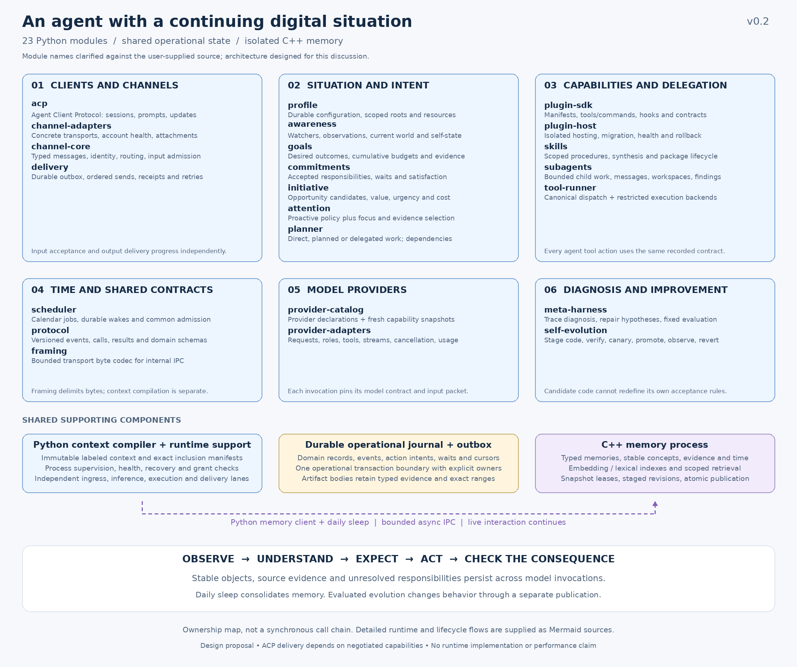
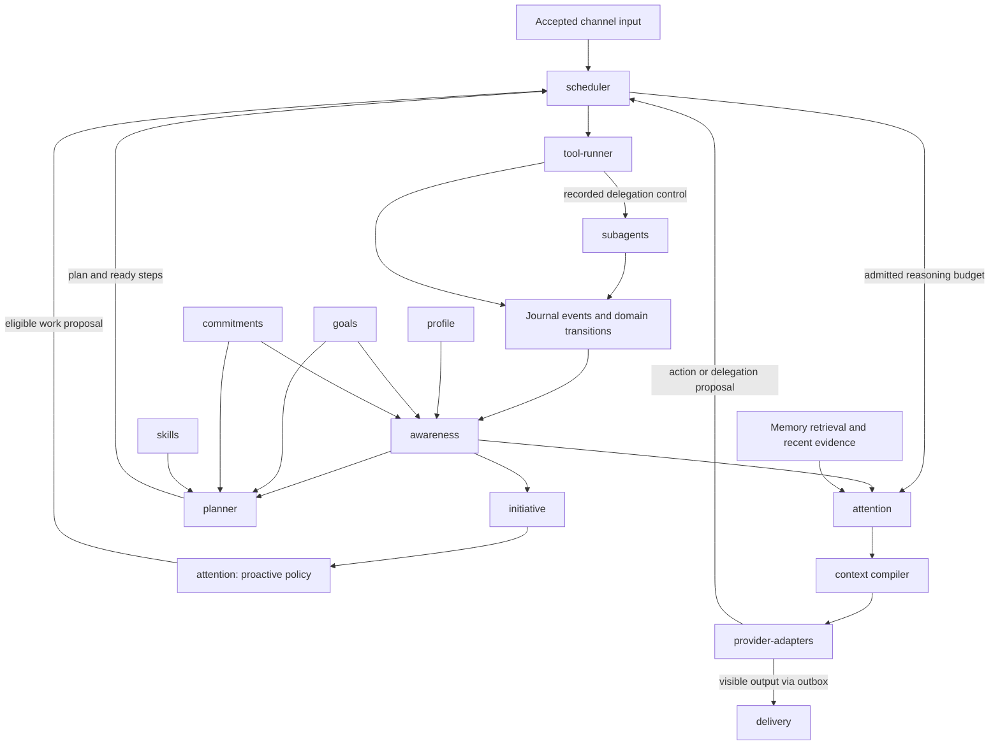
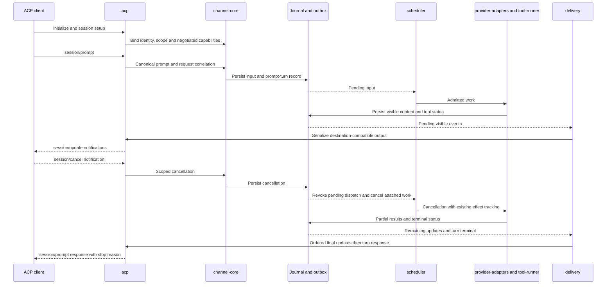
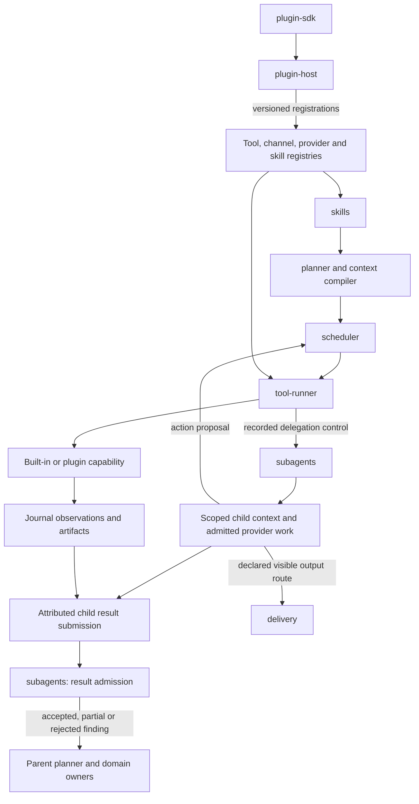

# Agent module map — v0.2

Date: **12 September 2026**. Status: **design proposal; no agent implementation**.

This extends the [architecture schematic](agent-architecture-v0.2.md) and [interface contracts](agent-interface-contracts-v0.2.md) to account for **all 23 modules requested by the user**. `acp` is confirmed to mean **Agent Client Protocol**, the external client integration boundary. Python owns the agent modules; the C++ memory engine remains a separate supporting process.



[Vector module map](diagrams/v0.2/module-map.svg)

The user subsequently supplied `/root/agent-keith` to clarify module division. The [source reference](keith-module-reference-2026-09-12.md) records its current module meanings and the explicit extensions proposed here. This design remains a new Python architecture; no prior project memories or implementation code were imported.

## 1. Complete module ownership

Public module labels retain the user's spelling. Python imports replace hyphens with underscores. An owned record means the module defines and validates its state transitions, not that each module gets a separate database or event loop.

### Client and channel integration

| Required module | Owns | Consumes → produces | Boundary |
| --- | --- | --- | --- |
| `acp` | ACP negotiation, connection/session bindings, request correlation, prompt-turn completion | External ACP requests ↔ canonical channel events and serialized ACP updates | External wire protocol; does not define internal agent state or schedule model calls. |
| `channel-adapters` | Transport-specific decoding/encoding, connection mechanics, attachment transfer, capability observations | Channel wire events ↔ typed inbound/outbound transport records | ACP is a specialized implementation registered here; no second decoding pass is required. |
| `channel-core` | Conversation routing, participant identities, reply targets, capability snapshots, durable input admission/deduplication | Adapter inputs → accepted canonical events; output intent → resolved destination | Does not decide content, claim delivery, or execute plans. |
| `delivery` | Outbox items, stream ordering, retries, replay cursors, terminal delivery status | Persisted visible content + resolved destination → adapter sends and receipt events | A successful send and a receiver acknowledgment remain different states. |

### Situation, intent, and reasoning

| Required module | Owns | Consumes → produces | Boundary |
| --- | --- | --- | --- |
| `profile` | Durable profile registry, canonical data/workspace roots, configuration/resource snapshots, explicit identity and defaults | Authorized registration/configuration and revision-checked updates → scoped profile snapshot | Defines resource/data boundaries; inferred preferences or profile edits cannot grant evolution authority. |
| `awareness` | Watcher registrations/cursors, normalized observation ledger, evidence-linked world/self-state projections, noise handling and expectation assessments | Journal observations and domain transitions → situation snapshots and material-change events | Does not overwrite canonical goals, commitments, actions, or external source records. |
| `goals` | Desired outcomes, rationale, priority, scope, success criteria, parent relationships, budgets/usage, continuation and progress evidence | Explicit intent or permitted proposals → goal revisions and activation/achievement assessments | An outcome definition; it does not contain scheduling authority. |
| `commitments` | Accepted responsibilities, beneficiaries, triggers/deadlines, satisfaction criteria, cancellation, evidence | Accepted responsibilities and observed results → commitment transitions and due work requirements | A promise survives low relevance, memory pruning, and context compaction. |
| `initiative` | Validated opportunity/obligation candidates with value/confidence/urgency/cost/expiry, trigger history, cooldowns, deduplication and proposal disposition | Situation changes, due events, active goals and operating scope → work proposals | Can initiate useful work through existing granted scope; it never invents additional permissions or launches a private loop. |
| `planner` | Task classification/routing, versioned plans, dependency graphs, assignments, preconditions, result checks, alternatives and step/action mappings | Goals, commitments, situation, skills/capabilities → plans and ready-step proposals | Proposes execution; scheduler admission and tool-runner dispatch remain separate. |
| `attention` | Proactive attention decisions using urgency, workload, autonomy, quiet hours, duplication and cost; focus/evidence/context allocations | Initiative candidates and current situation → eligible/deferred proposals; admitted reasoning → evidence selection | Policy eligibility is distinct from scheduler admission. Context allocation is an explicit extension; neither path erases accepted input. |

### Runtime and context contracts

| Required module | Owns | Consumes → produces | Boundary |
| --- | --- | --- | --- |
| `scheduler` | Interval/calendar/cron schedules, timezone/DST and missed-run policy; shared work admission, fairness, allocations, leases, retries and authority generations | Accepted input, work/step/delegation proposals, health → admitted work and state transitions | The single work-admission authority for foreground, child, maintenance, and improvement jobs. |
| `framing` | Bounded byte-stream codecs: length prefix, partial buffers, maximum frame size, EOF/truncation errors | Internal transport bytes ↔ complete bounded message frames | Shared low-level codec for compatible IPC; it does not assemble prompts. ACP stdio keeps its required newline framing. |
| `protocol` | Canonical event/tool/context/domain message schemas, IDs, versions, compatibility rules, error/lifecycle vocabulary | Module and adapter data → validated canonical contracts | Shared definitions, not an orchestrator or a second implementation of ACP. |
| `meta-harness` | Trace diagnosis, causal-fault classification, falsifiable repair hypotheses, bounded candidate evaluation/selection | Evidence traces and admitted candidate populations → diagnosis, evaluation and eligibility evidence | Independent evaluator boundaries remain outside candidate control. General process supervision belongs to supporting runtime infrastructure. |

### Model providers

| Required module | Owns | Consumes → produces | Boundary |
| --- | --- | --- | --- |
| `provider-catalog` | Static provider identities, transports, authentication modes/endpoints/defaults; separate versioned model/capability/availability snapshots | Configuration, adapter capability observations/probes → provider selection metadata | Capability knowledge; not a new model executor or permission authority. Dynamic facts carry timestamps and can be unknown. |
| `provider-adapters` | Provider-specific serialization, network calls, stream decoding, cancellation, usage and errors | Admitted model request + ContextPacket + catalog revision → canonical model events | Preserve roles, tool-call/result causality and finite input snapshots; no invented provider features or silent content loss. |

### Capabilities, collaboration, and improvement

| Required module | Owns | Consumes → produces | Boundary |
| --- | --- | --- | --- |
| `plugin-sdk` | Extension manifests, typed interfaces, canonical types, compatibility rules, contract fixtures | Extension definitions → validated packages and declarations | Authoring library/schema package; it is not an independently running authority. |
| `plugin-host` | Durable installation, staging, compatibility, isolated execution, registrations, draining, health, migration, rollback, quarantine and uninstall | Plugin packages and configuration → versioned tool/channel/provider/skill registrations | Executes extension lifecycle in bounded isolation. Declared capability requirements are requests, not grants. |
| `skills` | Versioned procedure packages, assets/scripts, preconditions, compatible tools, completion criteria, validation evidence | Authored procedures or procedural-memory candidates → applicable pinned skills | Packages behavior. Multi-step execution uses planner/scheduler; scripts use tool-runner. |
| `subagents` | Delegations, child identity/scope, workspace modes, messaging/waits, liveness/recovery, retention, result admission and cancellation/reassignment | Admitted delegation → scoped child work; attributed results → accepted/partial/rejected findings | Uses the same scheduler, providers, tools and delivery contracts. A child cannot enlarge its parent allocation or authority. |
| `tool-runner` | Restricted process and rooted filesystem execution; canonical dispatch facade for contract validation, recorded attempts, normalization and reconciliation | Admitted action proposal → progress, result, artifact and effect-evidence events | The common attempt-execution path for built-in, plugin, skill and child tool actions; goal fulfillment remains with domain owners. |
| `self-evolution` | Evidence-linked improvement candidates, staged changes, evaluation references, activation decisions, observation and rollback history | Failures, repeated corrections, experience, evaluations → candidate behavior or permitted implementation revisions | Improves methods within configured scope; cannot redefine its own authority or certify success using only its own narrative. |

The journal, artifact store, context compiler, runtime supervisor, memory client, C++ memory engine, and sleep coordinator are supporting components. Adding these 23 modules does not remove memory or the durable input/output foundation.

## 2. Avoid overlapping authority

**Awareness, attention, and context:** awareness describes what is observed, pending, uncertain, and unavailable. Attention evaluates proactive candidates and selects the relevant evidence/focus for admitted reasoning. The supporting `context` compiler constructs the immutable packet. `framing` only delimits transport bytes. The scheduler decides when admitted work runs. A label or summary cannot replace a source's actual status.

**Goals, commitments, and plans:** a goal expresses a desired outcome. A commitment adds an accepted responsibility, beneficiary, timing/trigger conditions, and satisfaction criteria. A plan proposes how to reach an outcome. A completed step may advance a goal while leaving delivery or other commitment conditions unmet.

`goals` owns cumulative outcome budgets and usage. Scheduler reservations debit those authoritative ledgers atomically and carry lease-scoped allocations; they do not create a second independent goal balance. Limit exhaustion produces an explicit continuation/stop disposition.

**Initiative and scheduler:** initiative can propose useful work in response to changes without a new user message. Existing autonomy settings determine which proposals can activate automatically. Attention evaluates urgency, interruption cost, workload, autonomy, quiet hours and duplication before presenting eligible initiative proposals. Scheduler admission applies capacity, scope and fairness. User input reaches scheduling directly; initiative does not gate it.

**Meta-harness, evolution, and runtime supervision:** meta-harness diagnoses traces and evaluates repair hypotheses. Self-evolution stages code/harness candidates, arranges shadow/canary execution and records promotion or reversal. The supporting runtime supervisor manages processes and recovery, including restarting the scheduler. Recovery resumes durable grants and never upgrades a stale run or unknown action into success.

**Profile and authority:** profile owns a durable registry of scoped configuration, resource snapshots, canonical roots and explicit identity/defaults, with references to runtime-granted scope. It is not a permission issuer. Learned user preferences live in evidence-linked memory until adopted under the applicable update policy.

**Provider catalog and adapters:** the catalog makes capabilities visible; adapters execute requests. A selected descriptor and adapter version are pinned to an invocation. An unsupported modality or structured-output requirement produces an explicit incompatibility rather than silent downgrading.

**Plugin host and tool runner:** the host owns the extension process. Tool-runner owns agent-directed action attempts. A channel/provider extension still performs its necessary transport I/O, under its admitted channel/model operation, and reports through that domain's contracts; it does not wrap every socket operation in a new agent tool call.

### Behavioral data flow

[Editable Mermaid source](diagrams/v0.2/06-behavior.mmd)



These arrows show information flow. Model-assisted planning, awareness enrichment, initiative reasoning, retrieval and attention iterations all run inside scheduler-admitted work. No arrow grants permission to start an unbudgeted inference loop. Deterministic event projection can update awareness without invoking a model.

`scheduler` preserves calendar/interval/cron work, timezone/DST handling, missed-run policies and bounded catch-up. The proposal explicitly expands it to own common work admission and allocations, which are separate crates in the reference system. One durable timer service serves commitment deadlines, initiative checks, plan wakeups, child deadlines, lease expiry, daily sleep and evolution monitoring. Durable subscriptions also cover child/process completion, file/repository changes, incoming messages and external conditions. A commitment arms its wake in the operational store before yielding compute; recovery reconciles pending/fired subscriptions by stable IDs. Other modules register timer intents rather than starting separate timing authorities.

## 3. ACP integration without losing the persistent entity

The reviewed ACP v1 documentation uses JSON-RPC methods and notifications for initialization, session setup, prompting, updates and cancellation. A prompt turn can encompass several model/tool exchanges. These are external client lifecycles; they do not define the lifetime of the agent's goals, memory, or ongoing responsibilities. [ACP overview](https://agentclientprotocol.com/protocol/v1/overview), [prompt turns](https://agentclientprotocol.com/protocol/v1/prompt-turn)

### Boundary mapping

| ACP surface | Internal mapping |
| --- | --- |
| `initialize` | `acp` negotiates protocol/capabilities and registers a channel capability snapshot. |
| `session/new` / supported `session/load` | `channel-core` maps an external session to an internal conversation/entity scope; existing records retain their identity. |
| `session/prompt` | Durable canonical input and a correlated prompt-turn record; scheduler controls subsequent work. |
| `session/update` | `delivery` selects committed visible events; `acp` serializes supported message, tool and plan updates. |
| `session/cancel` | A scoped cancellation request enters the journal/scheduler and propagates to attached work. |
| `session/prompt` result | The external prompt turn terminates with an appropriate stop reason after required updates; global commitments may remain explicitly pending. |
| Client file/terminal facilities | Negotiated capabilities become scoped tool-runner adapters; results use the same canonical tool envelopes. |

Capability negotiation controls which optional client operations are actually usable. ACP field naming remains native at the boundary; internal snake_case records are translated explicitly. [Initialization](https://agentclientprotocol.com/protocol/v1/initialization)

The initial interoperability target is ACP stdio: newline-delimited UTF-8 JSON-RPC, protocol-only stdout, separate logging on stderr. The reviewed v1 transport page still identifies Streamable HTTP as a draft. The Python SDK separately offers experimental remote transports; these should be qualified separately rather than advertised as the same baseline guarantee. Native-memory IPC keeps its own length-framed transport. [ACP transports](https://agentclientprotocol.com/protocol/v1/transports), [Python SDK web transports](https://agentclientprotocol.github.io/python-sdk/web-transport/)

### Prompt, stream, cancellation

[Editable Mermaid source](diagrams/v0.2/07-acp.mmd)



Ordinary ACP `session/update` notifications are one-way; they do not supply the custom contiguous receiver-acknowledgment mechanism described in the general delivery contract. On this adapter, transport writes remain `sent_unconfirmed` unless a separately negotiated capability supplies stronger evidence. Loading a session is also not proof of per-chunk acknowledgment or exactly-once replay. [ACP notification semantics](https://agentclientprotocol.com/protocol/v1/overview)

ACP cancellation must be mapped to the applicable prompt's model calls, tool attempts and attached delegations. Pending dispatch is fenced; active effects remain observable and reconciled. Useful long-lived responsibility may outlive a prompt only through explicit lifetime/scope records. It must not survive a cancellation accidentally because its task was orphaned. [ACP cancellation lifecycle](https://agentclientprotocol.com/protocol/v1/prompt-turn)

## 4. Plugins, skills, and subagents

`tool-runner` has two explicit internal layers: a canonical attempt-dispatch facade and restricted execution backends. The backends enforce process argv/environment, time/output/resource bounds, process-tree cancellation and capability-rooted filesystem operations with preimage checks. Plugin/network/control tools implement registered executors behind the same facade; they are not all forced through an OS subprocess. This facade is a deliberate extension of the narrower reference crate.

### Capability publication

`plugin-sdk` declarations include package identity/hash, SDK/protocol compatibility, tool and command exports, configuration, required scopes, dependencies, resource needs, health/activation/migration/deactivation hooks, cancellation/streaming and operation schemas. Provider/channel/skill extension points are explicit additions to the reference SDK division. `plugin-host` stages and validates them, starts the isolated runtime, then publishes a capability snapshot.

Lifecycle: `discovered → staged → validated → active → draining → stopped`, with an explicit failed state. A replacement receives new work only after publication; accepted attempts retain their original plugin/tool versions. Disabling a plugin removes new eligibility and records unresolved existing attempts. Installation records, state migrations, rollback, crash quarantine and uninstall retain their own durable lifecycle evidence. WASM and isolated subprocess implementations are alternative host backends to evaluate behind this contract.

Skills package applicable procedures, instruction blocks, optional scripts and evidence, with built-in/profile/workspace/installed/learned discovery, deterministic precedence and private scope. Their own synthesis/review/regression/activation/rollback lifecycle remains in `skills`; `self-evolution` coordinates broader code/harness changes. Their lifecycle distinguishes candidate, available, deprecated and withdrawn revisions. C++ memory can search procedural evidence, while `skills` owns the published executable/instruction package. A versioned link connects them. Sleep can propose a skill revision without automatically activating it.

### Delegation and action path

[Editable Mermaid source](diagrams/v0.2/08-capabilities-delegation.mmd)



A delegation records its parent responsibility and authority lineage, objective, acceptance criteria, input/evidence references, child scope, allowed capabilities, deadlines, shared resource allocation, output route, and lifetime/cancellation relationship. Both temporary and retained child identities are representable; persistence never expands authority.

Child records also specify shared versus isolated workspace access, scoped message mailboxes, wait subscriptions, heartbeats and retention. Orphan recovery checks durable ancestry before reattachment; archive/delete is distinct from stopping live work. A memory-scout specialization has only bounded memory-read authority and returns pinned cited evidence; ordinary tools, workspace access, memory mutation and user delivery are excluded. Each child uses the same provider and tool protocols. Nested delegation draws from an explicit ancestor allocation, with limits on depth and resource use. Scheduler checks ancestry when admitting or dispatching work. Cancelling/revoking an ancestor fences pending descendant dispatches; already-authorized effects retain their reconciliation records.

A child result is a submission, not automatic truth. `subagents` checks shape, evidence, completeness, relevant object versions and acceptance criteria, then emits an accepted, partial or rejected disposition. Goals and commitments retain final authority over their own satisfaction criteria. Parent/child dependencies must reject cycles and avoid waiting for a parent while the parent waits for the child.

## 5. Self-evolution and daily sleep

[Editable Mermaid source](diagrams/v0.2/09-self-evolution.mmd)

Self-evolution includes code/harness change: evidence diagnosis → staged source/artifact → isolated build/verification → shadow/canary → promotion → watchdog/reversal. These mechanisms are proposed capabilities, not actions run by this task. It is broader than memory consolidation. Within configured change scope it can propose revisions to skills, procedures, planning heuristics, attention policies, lower-authority context templates, adapter/plugin implementations, or permitted Python/C++ code. Candidate generation and evaluation are background work admitted by the scheduler.

```mermaid
flowchart LR
    E[Experience, corrections and performance evidence] --> DIAG[meta-harness: diagnosis and repair hypotheses]
    DIAG --> SE[self-evolution candidate]
    SL[Daily memory sleep] -->|optional candidate evidence| SE
    SE --> ST[Isolated staged revision]
    ST --> MH[meta-harness: admitted evaluation]
    MH --> RES[Measured results and regressions]
    RES --> EL[Activation eligibility under configured policy]
    EL --> CAN[Shadow and canary under fixed criteria]
    CAN --> PUB[Compatible behavior generation publication]
    PUB --> WATCH[Observe subsequent outcomes]
    WATCH -->|regression| RB[Rollback compatible generation]
    RES -->|failed or unsupported| REJECT[Reject or revise candidate]
```



An evolution candidate includes its parent generation, exact diff/hash, affected modules, motivating evidence, expected benefit, compatibility constraints, evaluation plan/results, activation scope, and rollback reference. The candidate cannot alter the governing acceptance checks or grant itself wider change permissions.

The harness evaluates changes against fixed recorded scenarios and controlled environments. Replay does not repeat live external effects. Code/native changes require isolated build and compatibility verification in an eventual implementation; this design task runs none of them. Activation follows the existing configured authority and does not inherently require a new user approval for every permitted improvement.

Active work pins its behavior, skill, plugin, tool and context contract generations. New work can adopt a published compatible generation. A state/schema migration requires an explicit compatible migration and recovery plan; switching a pointer cannot undo an irreversible storage change. Rollback preserves historical evidence and does not undo prior messages or external effects.

Daily sleep publishes memory generations. Self-evolution publishes behavior generations. They are separate transitions with separate evidence; a memory summary cannot silently rewrite live operating code.

## 6. Proposed Python package map

```text
agent/
  acp/                  # Agent Client Protocol facade
  attention/            # proactive policy, focus, evidence allocation
  awareness/            # world/self-state projection
  channel_adapters/     # transport implementations and registry
  channel_core/         # routing, identity, admission
  commitments/          # accepted responsibilities
  delivery/             # outbox, ordering, transport receipts
  framing/              # bounded transport byte codecs
  goals/                # desired outcomes and evidence
  initiative/           # event-driven work proposals
  meta_harness/         # trace diagnosis, repair hypotheses, evaluation
  planner/              # plans, dependencies, expectations
  plugin_host/          # isolated extension lifecycle
  plugin_sdk/           # extension authoring contracts
  profile/              # durable configuration, resource/data scope
  protocol/             # canonical cross-module schemas
  provider_adapters/    # model serialization and execution
  provider_catalog/     # models, capabilities and availability
  scheduler/            # admission, budgets, timers, authority
  self_evolution/       # staged behavior/code improvement
  skills/               # versioned reusable procedures
  subagents/            # scoped delegation and result admission
  tool_runner/          # validated, recorded action execution
  context/              # immutable labeled packets and inclusion manifests
  runtime/              # composition, supervision, recovery, grant enforcement
  memory/               # native client, retrieval coordination, sleep
  state/                # journal, domain transaction helpers, projections
  artifacts/            # typed durable bodies and evidence references
native/memory/          # C++ records, concepts, indexes and generations
```

## 7. Required cross-module checks

| Interaction | What the eventual implementation must demonstrate |
| --- | --- |
| framing ↔ internal IPC | Split/truncated/oversized frames remain bounded failures; transport decoding never changes context authority. |
| ACP ↔ channel-core ↔ delivery | Correct session binding, ordered updates/termination, capability matching, and honest unconfirmed delivery. |
| attention ↔ context compiler ↔ providers | Same selected evidence and role semantics reach the actual invocation; no false inclusion acknowledgment. |
| goals ↔ commitments ↔ planner | Step completion cannot falsely fulfill a goal or a delivery responsibility. |
| awareness ↔ initiative ↔ scheduler | Material changes can trigger permitted useful work without duplicate loops or resource starvation. |
| plugin-sdk ↔ plugin-host ↔ tool-runner | Invalid or mismatched extensions cannot activate; every agent-directed effect retains a recorded attempt. |
| provider-catalog ↔ provider-adapters | Stale descriptors, unsupported modalities and provider failures produce explicit outcomes. |
| subagents ↔ scheduler ↔ tool-runner | Ancestor revocation and shared budgets apply to nested children at dispatch. |
| skills ↔ memory ↔ self-evolution | Searchable evidence, published procedure packages and behavior revisions retain distinct versions. |
| self-evolution ↔ meta-harness | Fixed evaluation evidence controls eligibility; failed revisions and incompatible migrations cannot silently replace live behavior. |
| all modules ↔ live I/O | Planning, plugin health, child work, native memory and daily sleep cannot suppress persisted user output or silently drop accepted input. |

These are design requirements and proposed verification scenarios. No runtime behavior or performance is certified by this document.
