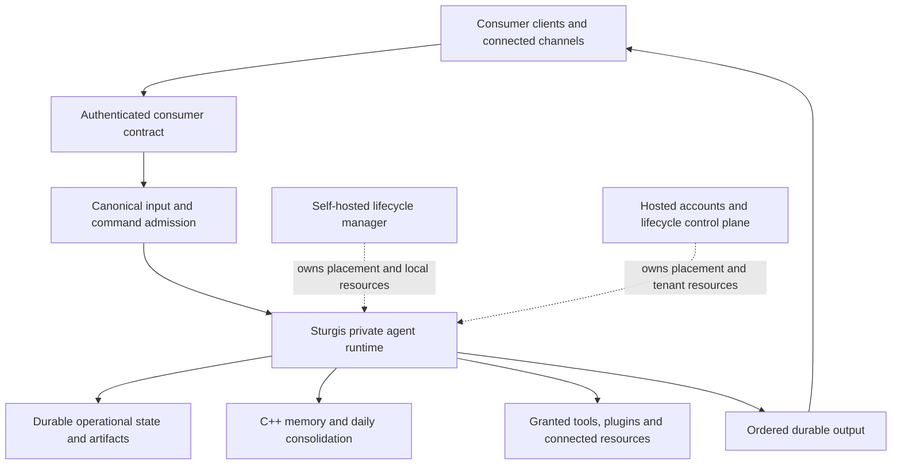

# Sturgis consumer features and installation modes: reference synthesis

Inspection date: 2026-09-12. Purpose: inspect Hermes, Neo and Gideon before selecting the sturgis-02 scope or consumer interface. This document records architectural implications and candidate feature families. It does not create an implementation spec or choose web, CLI, desktop or mobile as the first client.

## Inspection records

- [Hermes reference audit](sturgis-02-hermes-reference.md): current official agent source and the separately identified local deployment wrapper.
- [Neo reference audit](sturgis-02-neo-reference.md): consumer client, native agent, and distinct hosted/API stacks in `/root/private-neo-v1`.
- [Gideon reference audit](sturgis-02-gideon-reference.md): standalone/runtime variants, app bundles and the separate cloud control plane.
- [Sturgis core boundary audit](sturgis-02-core-boundaries.md): which consumer mechanisms already have a core owner and which product/deployment layers remain absent.

Memory was used to locate references. Current files and repository metadata provide the evidence for this audit. Historical claims of successful tests or deployments have not been promoted to present qualification. Donor services were not started, built, tested or changed.

## What each reference contributes

| Reference | Most useful material for this design discussion | Important distinction |
| --- | --- | --- |
| Hermes | Personal-agent installation and setup, provider/profile management, CLI/TUI and other client surfaces, skills/tools, messaging integrations, and current hosted relay/wake mechanisms. | The old remembered checkout is gone. Inspection uses a fresh official checkout at `b7b35a84b7fbe1aa2e223a6ce726a2471300d0a4`; profile multiplexing is not evidence of OS-enforced tenant isolation. |
| Neo | Consumer conversation/history and resumable streaming, attachment ownership, knowledge/library provenance, connected-app lifecycle, attention/work surfaces and authenticated private-runtime routing. | `/root/private-neo-v1` contains several separate systems. A client screen or API in one stack does not establish that feature in another stack. |
| Gideon | Broad end-user capability organization, guided first success, workflows/inbox/documents/media, installable app bundles, reusable private runtime, and central/reconciler/edge hosting responsibilities. | The newer clean runtime and the older tree with hosted additions contain different capabilities. The full and hosted navigation also differ. |

Gideon's inventory contains 52 external app manifests and 30 native manifests. The reusable extraction's 52 provider bundles duplicate the external catalog; they are not another set of integrations. The individual audit records the full inventory and declared types. Source count is not an installed or working connector count.

## Consumer feature families to carry into scoping

| Family | Consumer outcome | What must connect to Sturgis |
| --- | --- | --- |
| Installation and onboarding | Install, create or connect an agent, select a provider/model, configure credentials, and understand readiness. | Durable profile, runtime ownership, provider catalog and observed capability availability. |
| Conversations and continuity | Resume history, search or organize interactions, stream output, attach content, interrupt/steer work and reconnect. | Canonical input admission, immutable context, artifacts and the ordered durable outbox. A conversation view is a view onto persistent agent activity. |
| Work and responsibility | Inspect goals, accepted commitments, progress, delegated work, evidence and unresolved outcomes. | Existing goals, commitments, planner, scheduler and subagents. Product status must come from their records. |
| Inbox and proactive attention | See incoming events, proposed actions, reminders and items requiring a decision. | Initiative/attention policy, source identity, admission and delivery preferences. Proposed work and accepted responsibility remain distinguishable. |
| Automations and workflows | Create schedules, triggers and reusable multi-step procedures; inspect runs and failures. | Existing scheduler/planner/skills and durable wake handling. Hosted wake infrastructure must preserve the runtime's schedule ownership. |
| Knowledge and memory | Add documents, browse/search knowledge, inspect remembered information, correct or retract it and see evidence. | Artifact ingestion and the existing temporal memory system. Knowledge documents and recalled agent memories have different update and provenance needs. |
| Workspace and outputs | Upload/download files, inspect generated artifacts, manage workspaces and review changes. | Scoped artifact storage and bounded filesystem execution, with consumer ownership and transfer contracts. |
| Connections and channels | Connect messaging, mail and external services; manage identity bindings and connection health. | Channel adapters/core, approved credentials, capability discovery and normalized tool invocation. |
| Tools, apps, plugins and skills | Discover, install, configure, enable, update and remove capabilities or reusable procedures. | Existing plugin SDK/host, skills and tool runner. Product discovery, installation, credentials and actual runtime readiness are separate states. |
| Browser, research and computer use | Gather sources, operate browsers and act in a connected desktop environment. | Actual scoped executors and observation artifacts. A hosted browser and the user's physical desktop require different resource bindings. |
| Speech and media | Dictate, listen, attach images/audio/video and create supported media. | Typed artifacts plus selected input/output providers and their measured availability. Media storage is not the same capability as interpretation or generation. |
| Permissions and user control | Review capabilities, approve bounded actions, inspect activity, revoke access and stop work. | Authenticated human authority translated into scheduler grants, capability constraints and factual audit events. |
| Usage and ownership | Inspect consumption and limits, manage provider keys, export data, back up and restore. | Honest resource accounting, consumer credential management and a versioned data package across journal, memory and artifacts. Billing is a separate hosted service. |
| Operational support | Diagnose connection failures, provider errors, upgrades, recovery and unavailable dependencies. | Runtime health, durable error/effect states and versioned compatibility information. |

These families are an inventory for the next scope discussion. Brand-specific business features and every third-party connector are not automatically selected by inspecting the donors.

## Two installation modes around the same agent

The strongest architectural direction from the inspected boundaries is one consumer contract backed by the same Sturgis runtime in either mode. The following is a proposed division of ownership, not an implemented deployment.

| Concern | Self-hosted operation | Hosted operation |
| --- | --- | --- |
| Agent behavior | Local installation runs the Python core, native memory and registered capability executors. | A private runtime runs that same core and capability contracts. |
| Identity | Owner-controlled local authentication and optional external identity integration. | Account authentication and membership resolve the permitted private runtime. |
| Provisioning | Local installation/service manager owns paths, dependencies, start/stop and upgrades. | Control plane owns placement, compute/volume lifecycle, release rollout and recovery operations. |
| Data | Owner-selected persistent roots and backups. | Isolated persistent roots/volumes, scoped object access and tenant-specific backup/restore. |
| Model access | Owner-supplied providers and keys; local model endpoints where compatible. | BYOK and/or managed model access under the same provider contract. |
| Secrets | Owner-controlled secret store outside agent-writable workspaces. | Tenant secret service injects only the capabilities required by each runtime or connector. |
| Automation | Resident runtime and its durable timers. | Resident runtime or explicit authenticated wake service when suspension is supported. |
| Consumer surfaces | Selected clients connect to the local consumer API. | Those clients use the same consumer contract through authenticated routing. |
| Local devices | Capabilities bind to locally available, permitted resources. | Access to a user's device requires a separately authenticated device connection and granted executor; hosting alone does not provide it. |
| Commercial services | Installation does not require the vendor's subscription service. | Entitlements, payments, quotas and support can surround the private runtime. |

The local and hosted lifecycle managers are alternative deployment owners. Goals, action admission, plan state, memory publication and completion evidence remain owned by the core modules. The control plane's job is to make the correct private runtime available and route authorized traffic to it.

## Transfer details that matter

**Distinguish compute availability from accepted input.** Gideon's cloud router authenticates a request, resolves the account runtime, and enqueues a wake when it is sleeping; that branch returns lifecycle status before proxying the original request ([handler.go:90](/root/Gideon/gideon-cloud/internal/router/handler.go:90)). A Sturgis consumer contract must distinguish waiting-for-runtime from durably accepted input, preserve the user's submission, and retain a stable idempotency key across retries.

**Keep memory consolidation and hosted suspension separate.** Sturgis daily sleep is background memory processing. Gideon cloud's suspension path drains admission, checks active work, checkpoints stores, checks again and serializes the provider stop ([sleep_policy.go:50](/root/Gideon/gideon-cloud/internal/fleet/sleep_policy.go:50)). These are different operations with different owners. Accepted background responsibilities and scheduled occurrences must survive any hosted lifecycle transition.

**Confirm where inputs will go before suspending.** Current Hermes source requires its relay's dormancy acknowledgment, holds reconnect while suspension is pending, and rechecks idleness before stopping. Failed acknowledgment or newly arrived input abandons suspension ([pinned shutdown implementation](https://github.com/NousResearch/hermes-agent/blob/b7b35a84b7fbe1aa2e223a6ce726a2471300d0a4/gateway/run_shutdown.py#L432)). This is useful for Sturgis's uninterrupted I/O requirement: compute can sleep only after an explicit input-retention/wake handoff. The inspected agent-side code does not qualify the external relay service.

**Use an infrastructure interface with durable operations.** Gideon's provider contract separates compute, volumes, configuration, observation, immutable image updates, snapshots and scheduled wakes ([provider.go:13](/root/Gideon/gideon-cloud/internal/provider/provider.go:13)). That division is a useful reference for hosting compatibility without embedding one cloud vendor into the agent's cognition or consumer clients.

**Preserve factual consumption after an overrun.** Neo's inspected metering finalization can reject an actual usage value that exceeds quota before inserting the usage entry ([service.py:189](/root/private-neo-v1/neo-api/packages/metering/neo_metering/service.py:189)). Sturgis already records provider usage before signaling an overrun ([runtime:582](../agent/runtime/__init__.py#L582)). Consumer billing/limits should preserve that factual record and govern subsequent admission separately.

**Separate profiles, customer isolation and execution isolation.** A named profile, a routed conversation and an OS-enforced tenant boundary solve different problems. Hosting design needs explicit ownership for data, credentials, executors and runtime lifetime, even when the personal-agent product supports several profiles in one process.

**Expose actual capability availability.** Donor features may require provider credentials, installed bundles, an OS-specific driver, a connected local device or a hosted service outside the inspected repository. The next product should represent those dependencies and readiness states instead of inferring availability from a source directory or catalog listing.

## Status

This inspection prepares the next design discussion. Consumer-interface priority, selected integrations, initial hosting backend and sturgis-02 task boundaries remain open. No new application code or spec has been created. Sturgis-01's qualified production/build source remains unchanged.
