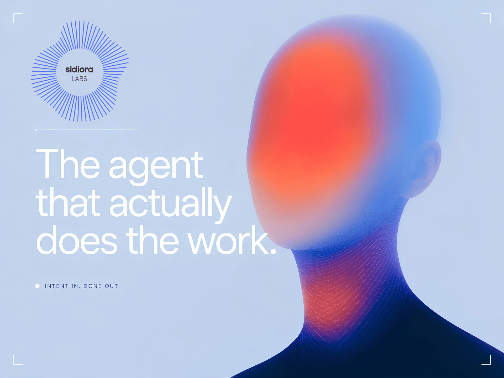
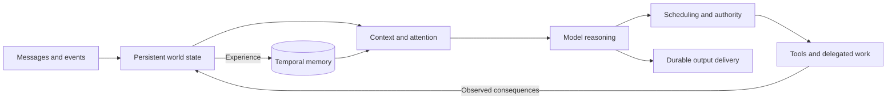

<div align="center">



# Sturgis

**An agent built to inhabit a digital world.**

<p>
  <a href="CHANGELOG.md"></a>
  <a href="SECURITY.md"></a>
  <a href="LICENSE"></a>
  <a href="pyproject.toml"></a>
  <a href="CMakeLists.txt"></a>
</p>

Sturgis is an experimental agent architecture from **Sidiora Labs**, built around
one idea: **the agent's existence continues between model calls.** Its identity,
understanding of its environment, responsibilities, and the consequences of its
actions belong to a persistent runtime. Each model invocation reasons from that
continuing state and contributes to what happens next.

[Architecture](#how-sturgis-works) · [Run locally](#run-locally) · [Documentation](#documentation) · [Contribute](CONTRIBUTING.md)

[GitHub](https://github.com/Sidiora-Labs/sturgis-agent-harness) · [Issues](https://github.com/Sidiora-Labs/sturgis-agent-harness/issues) · [Development checks](https://github.com/Sidiora-Labs/sturgis-agent-harness/actions)

> [!WARNING]
> **UNDER ACTIVE DEVELOPMENT — NOT FIT FOR PRODUCTION USE.**
>
> This is a development preview of an evolving architecture. Features are
> incomplete, bugs are expected, and APIs, configuration, and data formats can
> change. Use it for experimentation and development, not production workloads
> or critical operations.

## Why Sturgis exists

An agent needs a consistent relationship with its environment: what an action
means, what changed after it acted, what it knows, and what it still owes you.
Sturgis makes those relationships explicit parts of its architecture.

A responsibility can remain open after a conversation ends. An action can finish
while its intended outcome remains unproven. A memory can acquire new evidence
without erasing its original source. Changing the model should preserve the
agent's identity and accumulated situation.

These are the problems Sturgis is being built to address. Its core combines
persistent world state, predictable action contracts, deliberate context assembly,
and memory that changes over time.

## How Sturgis works

- **A continuing world.** Observations, goals, commitments, plans, and action
  records live outside the context window. Awareness projects those records into
  the situation the agent reasons about next.
- **Actions with defined meaning.** Tools share a canonical invocation and result
  contract. Validation, authority, execution, observed outcome, and expectation
  are tracked separately, including failures and uncertain results.
- **Context with provenance.** Each model call receives an immutable, labeled
  packet distinguishing instructions, user input, history, tool observations,
  and retrieved memory. Inclusion manifests record what entered the packet and
  what was deferred.
- **Memory with a lifecycle.** Temporal records and concept links preserve
  experience across time. The memory engine supports lexical, concept, and
  embedding retrieval. A daily sleep cycle stages consolidation and pruning
  while retaining evidence and revision history.
- **Independent input and output.** Separate admission, delivery, memory, and
  heartbeat tasks are designed to keep model and tool work from blocking
  conversation. A durable journal and outbox support recovery.
- **Delegation with continuity.** Subagents receive scoped responsibilities and
  shared resource limits. Their findings return through an explicit admission
  path to the parent agent's ongoing work.



The runtime is written in **Python**, with a separate **C++ memory engine**.
Models connect through an independent **Model Gateway**, which owns provider
connections, credentials, catalogs, and routing. The agent retains its identity
across model selections.

A **Material 3 web client**, CLI, and API expose the system for self-hosted use.
The same core has boundaries for hosted operation. Both deployment modes remain
experimental.

## Run locally

Use **Linux**, **Python 3.12**, **Node.js 22**, Make, CMake, a C++20 compiler,
SQLite development headers, bubblewrap, and util-linux. The
[development container](.devcontainer/README.md) provides a prepared toolchain;
[CONTRIBUTING.md](CONTRIBUTING.md) covers manual setup.

Clone the repository and start a local development instance:

<div align="left">

```sh
git clone https://github.com/Sidiora-Labs/sturgis-agent-harness.git
cd sturgis-agent-harness
make bootstrap
make browsers
make dev
```

</div>

Open **http://127.0.0.1:8787** and use the private installation token from
`.data/sturgis/bootstrap.token` for first-account setup. In **Model Gateway**, connect a provider and import a
model. Create an agent and select that model in its settings to start a conversation.

`make dev` keeps development data under `.data/sturgis/`. For another local port,
use `make dev PORT=8788`. See [.env.example](.env.example) for optional settings.
Keep provider credentials in the gateway and local data out of version control.

The gateway can also serve other compatible clients independently of an agent:

<div align="left">

```sh
.venv/bin/python -m model_gateway serve
```

</div>

Its dashboard opens at **http://127.0.0.1:8790**. See the
[standalone gateway guide](documentation/users/src/content/docs/getting-started/standalone-gateway.md)
for the administrator key and supported client protocols.

## Documentation

- **Using Sturgis:** [User manuals](documentation/users/src/content/docs/index.md)
  cover conversations, models, work, knowledge, files, and connections.
- **Building Sturgis:** [Developer documentation](documentation/developers/src/content/docs/index.md)
  covers the architecture, module contracts, integrations, and source reference.
- **Exploring the design:** [Architecture schematic](.research/agent-architecture-v0.2.md)
  and [module map](.research/agent-module-map-v0.2.md) preserve the original design.
- **Running the docs sites:** [Documentation setup](documentation/README.md).

## Contributing

Sturgis needs work on runtime reliability, memory quality, integrations, and the
experience of using a persistent agent. Start with
[CONTRIBUTING.md](CONTRIBUTING.md) for the toolchain, local checks, and contribution
workflow. Run `make help` for available commands.

The full qualification gate retains independent **90% executable-line coverage**
requirements for Python, C++, client JavaScript, and gateway Python. Tests and
coverage support development; they do not establish production readiness.

[Changes](CHANGELOG.md) · [Security reporting](SECURITY.md) · [Contributors](CONTRIBUTORS.md)

## License

[Apache-2.0](LICENSE). Third-party components retain their own licenses; see
[NOTICE](NOTICE) and [third-party notices](THIRD_PARTY_NOTICES.md).

</div>
