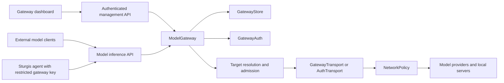

`model_gateway` is an independent model infrastructure package. It owns upstream connections, account authentication, model discovery, client API keys, routing, and usage. It does not own agents, goals, conversations, tool execution, or native memory. The standalone process and embedded Sturgis composition use the same package.

## Composition boundaries

`create_app` composes a standalone Starlette service with administrator authentication, callback listeners, gateway APIs, and optional static dashboard assets. `python -m model_gateway serve` launches it; no consumer controller or worker is required.

`consumer.gateway.ConsumerGateway` composes the package behind Sturgis's existing principal/session boundary. It derives the gateway tenant from the authenticated account, rather than accepting a tenant ID from the request body. Its `select` operation authorizes management of the target agent before binding a gateway model.

An agent binding creates a gateway client key restricted to the selected model or route. The worker receives the gateway endpoint and that restricted key, never an upstream API key or provider refresh token. Binding state retains request identity across uncertain worker acknowledgement. A pending binding to one model must be reconciled before a different selection replaces it. Superseded client keys are revoked only after the replacement binding is established.

An explicit same-model selection after an acknowledged active or failed result starts a fresh worker request using the existing valid restricted key. This lets **Retry tool check** exercise the corrected/current capability contract rather than replay a cached text-only result. A pending request preserves its original identity to reconcile uncertain delivery. The worker may reuse a fresh matching readiness observation, or reconfigure/reprobe when its current settings differ from the requested capabilities.

## Module ownership and important entry points

| File | Responsibility and control points |
| --- | --- |
| `__init__.py` | Independent package identity and version; does not initialize an agent or import consumer composition. |
| `__main__.py` | CLI arguments, root/listener selection, default built dashboard detection, and Uvicorn startup. Wildcard listeners require a public origin. |
| `api.py` | Strict bounded HTTP bodies; management dispatch; standalone admin sessions; app-key inference authentication; response envelopes and stream completion. |
| `service.py` | `ModelGateway` coordinates presets, discovery, manual checks, connection mutations, model aliases, routes, keys, and request dispatch. `_targets` resolves client-visible names. `_stream_target` selects the wire path. |
| `store.py` | `GatewayStore` owns SQLite transactions, private files, revision checks, encrypted secret rotation, hashed app keys, connection deletion, and factual usage. |
| `catalog.py` | Preset metadata and endpoint normalization. A preset is a starting configuration, not evidence that an account can use every model. |
| `network.py` | Canonical origins, DNS/address admission, socket pinning, TLS host preservation, byte/time/concurrency bounds, and redirect rules. |
| `transports.py` | API-provider discovery, safe provider errors, SSE framing, managed stream cancellation, and native passthrough. |
| `translation.py` | Chat-to-provider request mapping, normalized stream state, bounded tool fragments, usage normalization, and Gemini function signature correlation. |
| `ingress.py` | Messages/Responses client conversion, native result assembly, and explicit rejection of unsupported stored/background semantics. |
| `auth.py` | Device-code and PKCE sign-in, account-specific bootstrap, safe projections, provider credentials, and refresh orchestration. |
| `auth_state.py` | Atomic session completion and persisted cross-process refresh leases. Cancellation and disconnect can supersede an in-flight exchange. |
| `auth_transports.py` | Actual account model discovery and Copilot/Codex/Gemini CLI/Kiro wire execution. AWS binary framing belongs here. |
| `callbacks.py` | Bounded loopback callback listeners attached only to provider-validated pending sign-ins; autonomous expiry, separately joined retired listeners, and fenced shutdown. |
| `controls.py` | Tenant settings, transactional minute-rate admission, consistent credential-free export, and atomic import of disabled connections with remapped routes. |
| `wire.py` | Strict JSON encode/decode; malformed or non-finite wire values do not become trusted protocol state. |
| `errors.py` | Safe `GatewayError` code/message/retryability. Raw upstream bodies and credentials are excluded from public errors. |

## Durable state and authority

The gateway root contains a private SQLite database and private key files. `objects` uses `(tenant, kind, id)` as its primary identity and a monotonically increasing revision. `secrets` uses `(tenant, id)` and stores nonce/ciphertext. `client_keys` stores a SHA-256 digest, metadata, allowed model names, and revocation state. `usage` records each attempted provider request separately.

`GatewayStore.transaction` serializes local work using a reentrant lock, opens SQLite with `BEGIN IMMEDIATE`, and commits or rolls back explicitly. `PRAGMA synchronous=FULL` preserves the selected durability behavior. Network I/O does not run inside these local database transactions.

Upstream API keys and native token bundles use AES-GCM. Associated data binds ciphertext to its tenant and secret reference. A secret from one tenant or reference cannot be decrypted under another identity. An update that rotates a secret deletes the old ciphertext and writes the new object revision in the same transaction. Public connection projections remove `secret_ref`; public account/session projections explicitly enumerate non-secret fields.

The root must be private and owned by the service user. Existing secret/database files must be regular private files with a single link; symlink and unsafe-permission checks precede reads. Losing `master.key` prevents recovery of encrypted records. App-key hashes cannot be turned back into the one-time issued key.

## Discovery versus inference evidence

A normal connection imports a live catalog. Discovery normalizes provider model names, positive capability metadata, and available limits; missing limits use conservative preset defaults. It rejects malformed catalogs, known non-chat model families, unsupported content modalities, and unbounded pagination. Imported model IDs remain distinct from namespaced gateway aliases.

`connect` validates the current connection revision, rediscovers the catalog, and requires each selected ID to remain present before saving. `refresh` preserves the owner's imported set, removes withdrawn models, and does not silently import newly added catalog entries. A connection whose imported models are all withdrawn becomes an error state.

An explicit `catalog_mode:"manual"` skips catalog discovery and checks each declared model with a short text inference request before saving. It imports at most 16 models and uses preset fallback limits labeled as manual import. Ordinary discovered imports permit up to 256 selected models. A manual check is usage-bearing management work, not a claim that the model's context or tool support was measured.

Output allowances use the same domain through discovery, request validation, and translation: up to 2,000,000 tokens, subject to the selected model's smaller imported limit. `ModelGateway._payload` validates the generic integer bound, while `_stream_target` enforces the specific model. Consumer readiness uses smaller requests: up to 128 output tokens for text and 1,024 for tool checks, each capped by the imported allowance. Ordinary agent work uses the selected configuration's output allowance. `tests/gateway/test_model_limit_compat.py` checks the entire activation-to-conversation path with an advertised 384,000-token model, including native client conversion and rejection above the imported limit. A successful small probe alone would not detect a conflicting bound on the later conversation request.

## Request lifecycle and routing

1. Parse a bounded client request and validate supported roles, tool count, and output parameters.
2. Authenticate the gateway app key and derive its tenant and permitted names.
3. Resolve a namespaced model or a named route. A restricted key must allow the client-visible name; it cannot select an arbitrary upstream directly.
4. Admit the request through the tenant's transactional minute-rate limit, per-tenant concurrency, and operator concurrency ceiling. Resolve the route's priority or round-robin starting order and skip cooling-down targets.
5. Reauthenticate the key and reread the connection and selected route revisions immediately before dispatch. A changed connection or route causes a conflict instead of applying stale credential/configuration assumptions.
6. Resolve the current API secret or authenticated account binding. Select public translation, native passthrough, or the account-specific transport.
7. Yield response chunks under backpressure. Once any chunk has been emitted, do not switch to another target.
8. Record factual usage and attempt status in `finally`, including failures and cancellations. Release the concurrency slot.

Before output, retryable provider failures and selected unavailable/authentication errors may advance to another target. Eligible failures create a temporary cooldown. After output, the current error remains the outcome; the gateway cannot splice two providers' answers together. Round-robin counters and cooldowns are process-local, so they are not a distributed load-balancing guarantee.

The transport's managed producer uses a queue of one item. One task owns the complete upstream HTTP context, including its deadline and cleanup. Cancellation races the next read, cancels child tasks, closes generators, and releases resources. Slow consumers exert bounded backpressure rather than accumulating an unbounded stream buffer.

### OpenRouter final usage envelopes

`StreamTranslator._openai` accepts a narrow provider extension after its completion reason: a final usage event may repeat choice index zero with the identical finish reason and an empty delta. The delta may contain only `role`, `content`, `refusal`, and `tool_calls`; the role must be assistant or null, text/refusal must be empty or null, and tools must be empty or null. The index must be an integer, excluding booleans. New content, tool fragments, reasoning fields, a changed completion reason, or a repeated choice without usage remains a protocol error.

The accepted envelope updates validated, nondecreasing usage without emitting another choice or terminal. `end` still requires `[DONE]` and emits normalized final usage once. For example, an upstream `stop` chunk followed by an empty repeated `stop` with 34 prompt tokens and 14 completion tokens produces one completion and a 48-token usage report. This trailer rule does not convert a truncated completion into success; readiness output allowances are a separate request contract.

`tests/gateway/test_openrouter_compat.py` exercises that envelope over controlled HTTP, including consumer model selection through the private worker and embedded gateway, followed by a conversation. Both text-only and tool-capable bindings must succeed without an extra failed probe, and both gateway and agent accounting must retain the final usage. Negative cases cover new output, changed reasons, decreasing counts, malformed deltas, and a missing terminal marker.

## Settings and configuration transfer

`GatewayControls.settings` overlays durable tenant settings on operator defaults and returns both the current revision and operator ceilings. A write must provide the displayed revision. Request timeout/concurrency cannot exceed those ceilings; the per-minute count is 1–10,000. A SQLite transaction increments a minute-window record before dispatch, including concurrent processes. Per-process concurrency counters remain bounded by the composition's operator limit.

Lowering an operator ceiling clamps effective saved timeout/concurrency after restart without rewriting the original persisted preference. Settings edits and backward wall-clock movement cannot reset an already consumed minute window. A later minute starts a fresh counter.

Export snapshots only public connection fields, model metadata, routes, and settings under one consistent transaction. Its format is `sturgis-gateway-config/1`. It excludes secrets, native account records, administrator material, app-key hashes/values, and usage. This is reproducible configuration transfer, not an encrypted vault backup.

Import validates the bounded archive before writing, allocates new connection IDs, rewrites route targets, and commits connection/route records together. Imported connections have `reconnect_required`, no credential/account reference, and no execution authority. Refresh cannot activate them. An explicit normal connect/edit performs discovery or manual inference checks with current credentials before making them usable. Imported settings remain unapplied so metadata cannot enlarge a target installation's resource limits. Copying the complete stopped installation directory with its master key is a different recovery operation.

## Protocol limits and preservation

The Chat Completions ingress accepts one response choice, supported conversation roles, bounded tool definitions, and complete caller-supplied history. Messages and Responses ingress either preserve the matching upstream native format or translate supported ordinary conversation content. Stored response IDs, background jobs, and unsupported server-hosted tools are rejected instead of being simulated.

Native passthrough preserves signed or opaque provider blocks only when the client and target protocol match. A cross-protocol translation cannot reconstruct arbitrary encrypted reasoning or provider-managed history. Gemini function-call correlation retains bounded native signatures in transport memory; this is not a durable conversation store. See [HTTP contracts](http-api.md) and [authentication transports](authentication.md).

## Network policy and hosting

Provider and account traffic uses the package's `NetworkPolicy`, not an unrestricted ad hoc HTTP client. The caller supplies allowed origins. DNS is resolved once for each authorized destination and the selected address is pinned to the actual connection; TLS and Host still refer to the logical host. Unspecified and multicast addresses are always rejected. Other non-global addresses require the applicable exact private-origin permission. Provider calls disable redirects.

Standalone and embedded self-hosted compositions may permit explicitly chosen loopback model servers. Hosted composition does not infer customer private-network grants from an endpoint entered in a browser. This gateway-only permission does not expand any agent tool's network authority.

## Validation and extension rules

Add provider presets only when the selected transport and discovery path can support them. Add a native account only with its real sign-in, refresh, bootstrap, catalog, and wire behavior; a tile alone is not an integration. Keep credentials out of public projections and logs, test malformed/truncated streams, and test cancellation and pre-output fallback boundaries with controlled HTTP sockets.

Preserve separate proof levels: source inventory, unit/fixture behavior, real local HTTP journeys, and actual vendor-account access are different evidence. Run the product coverage gate and both complete documentation sites for a release. Do not describe fixture accounts as live vendor authentication.

## Implementation sources

- [model_gateway/__init__.py](/reference/files/model_gateway/__init__.py/)
- [model_gateway/__main__.py](/reference/files/model_gateway/__main__.py/)
- [model_gateway/catalog.py](/reference/files/model_gateway/catalog.py/)
- [model_gateway/controls.py](/reference/files/model_gateway/controls.py/)
- [model_gateway/wire.py](/reference/files/model_gateway/wire.py/)
- [model_gateway/service.py](/reference/files/model_gateway/service.py/)
- [model_gateway/store.py](/reference/files/model_gateway/store.py/)
- [model_gateway/network.py](/reference/files/model_gateway/network.py/)
- [model_gateway/transports.py](/reference/files/model_gateway/transports.py/)
- [model_gateway/translation.py](/reference/files/model_gateway/translation.py/)
- [consumer/gateway.py](/reference/files/consumer/gateway.py/)

Provider identifiers, protocol references, and licensing/provenance notes are recorded in `model_gateway/THIRD_PARTY_NOTICES.md`. They do not imply endorsement or vendor-account access; the research/spec reference identifies the examined 9router revision and separates source inspection from implemented capability.

[HTTP API](http-api.md) · [Authentication](authentication.md) · [Frontend](frontend.md)
