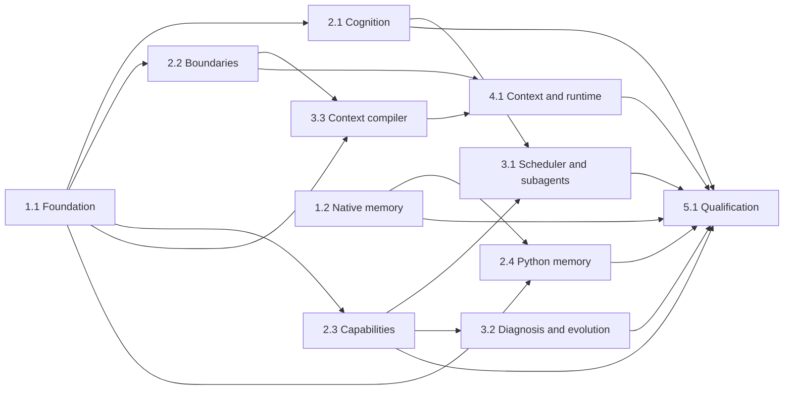

# Parallel execution plan

Root coordinates a maximum of **four live agents including root**. The dependency graph controls eligibility; wave numbers communicate order but do not require unrelated work to wait behind a slow sibling. Root alone edits `spec.kvx`, shared manifests/build tooling and qualification evidence. Each worker owns its production paths and one focused test file.

| Stage | Root | Worker 1 | Worker 2 | Worker 3 |
| --- | --- | --- | --- | --- |
| Foundation | 1.1 common contracts/state/test tools | 1.2 native memory | Available for bounded spec/API review | Available for bounded spec/API review |
| Independent domains | 2.2 channels/providers/ACP/delivery | Finish native then 2.4 client/sleep | 2.1 cognition | 2.3 capabilities |
| Composition preparation | 3.3 context compiler after boundary contracts; runtime composition proceeds against agreed domain interfaces | Native/Python memory validation | 3.1 scheduling/children | 3.2 diagnosis/evolution |
| Integration | 4.1 continuous runtime and real cross-module journeys | Narrow assigned fixes | Narrow assigned fixes | Narrow assigned fixes |
| Qualification | 5.1 aggregate gates/evidence/spec closure | Disjoint coverage/recovery fixes only when assigned | Same | Same |

## Coordination rules

1. Root records the task claim before implementation. Agents read `contracts.md`, their requirement clauses and current source. No prior project memories or reference implementation code are imported.
2. Declared dependencies wait for focused verification. Frozen foundation interfaces allow native work to proceed independently. Runtime implementation can proceed against agreed domain interfaces while their owners finish; its focused integration verification requires those actual modules, and final qualification explicitly depends on every domain lane.
3. Agents never write another lane's files. Required cross-lane changes are sent as a concrete API request to root. Root settles shared changes before dependent code uses them.
4. Agents publish their public API and exact focused test command/result. Root checks integration, synchronizes Codify, and advances spec status. Tests are not optional at handoff.
5. Each native build directory has one owner. Build C++ once incrementally and reuse the compiled worker across Python integration tests. Do not run competing full builds or install dependencies concurrently.
6. Focused tests run during each task. The full coverage suite runs after composition; broaden/repeat only to resolve new changes or failures. Qualification artifacts are written by root.
7. A task is pending/in_progress/done according to observed verification. If a gate fails, preserve evidence and fix its cause; do not lower coverage, omit files or substitute a fake implementation.

## Critical integration checkpoints

- **Foundation:** strict parser, revisioned state and bounded framing APIs are frozen and tested.
- **Native:** compiled worker speaks `memory/1`, persists/reopens records and reports generation/conflict/error semantics.
- **Domain:** all named modules have concrete behavior and adversarial tests, not empty packages.
- **Runtime:** actual registered providers, tools, memory and outbox operate together while steering arrives during work.
- **Qualification:** both language coverage floors, recovery journeys, source scope and documentation checks pass. Only then can sturgis-01 be complete.

Context compilation is a separate task (3.3) so root can implement and verify it while cognition, capabilities and native memory finish. Its input is a supplied attention selection; the actual attention/runtime binding is qualified in 4.1.
