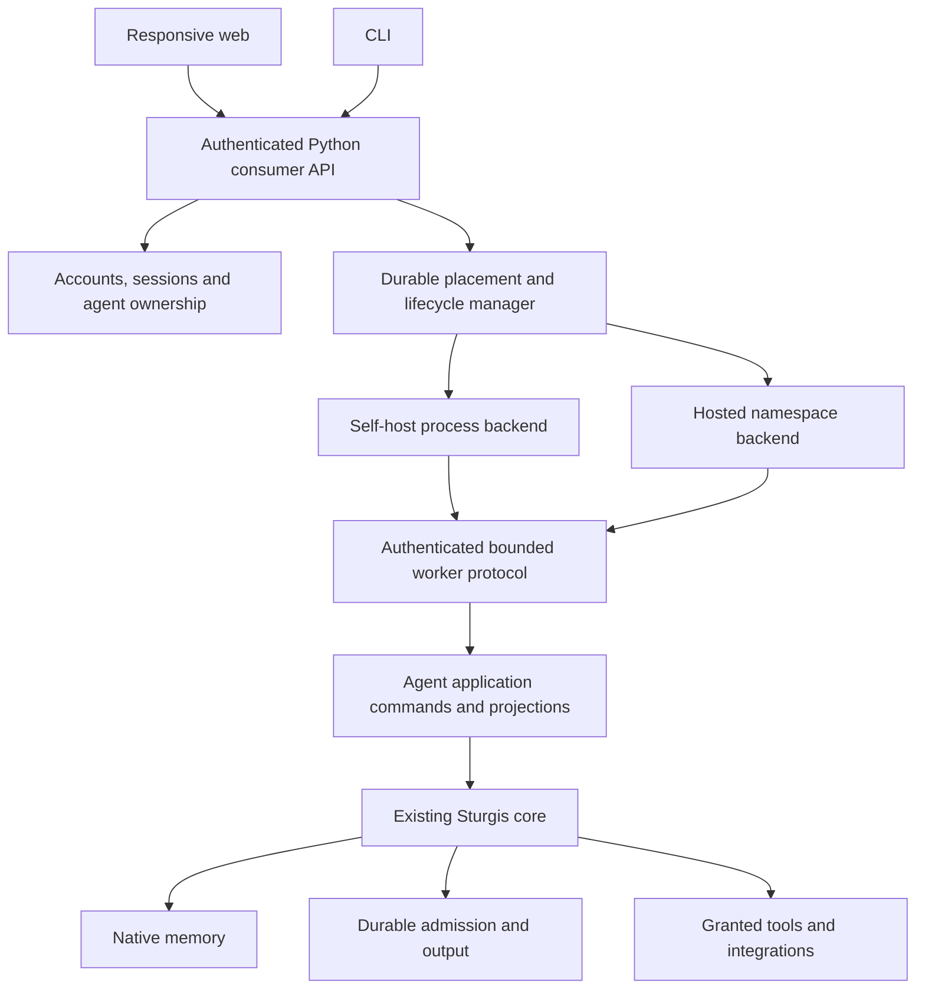

<!-- GENERATED by cg spec render from spec/ kvx — DO NOT EDIT. -->

Existing core authority with authenticated consumer commands, private runtime lifecycle, usable clients and source-backed capability breadth.

# Sturgis 02: consumer product and portable hosting

Build a usable responsive web client and CLI over a shared Python consumer API. Both self-hosted and hosted installations run the same Sturgis core, C++ memory and consumer command contracts. The authenticated application owns account/agent mapping, presentation and deployment lifecycle; existing core modules retain action authority, work state, context, memory and evidence.

The source-grounded input is [.research/sturgis-02-reference-synthesis.md](../../.research/sturgis-02-reference-synthesis.md), with individual Hermes, Neo and Gideon audits. Reference implementations are not copied. All consumer families are classified in [feature-map.md](feature-map.md).

## Concrete first release

- Python package `consumer/`, with packaged HTML/CSS/JavaScript assets and `sturgis` CLI. The embedded web client is served by the same portable Python application; no proprietary site host, vendor login or cloud database is required to self-host.
- Account bootstrap/login/session revocation; owner-to-agent authorization; encrypted credential storage; provider setup and observed readiness; capability policy and bounded human approvals.
- Conversations, stable input IDs, stream/history replay, steering/cancellation, attachments, artifact preview/download, work/automation/inbox views, files/knowledge/memory administration, integrations and usage.
- Concrete bounded HTTP/search, HTTP MCP, browser/CDP, media HTTP and signed webhook integrations; a scoped remote-device protocol. Unsupported devices/providers remain explicitly unavailable. Generic adapters do not imply compatibility with every vendor.
- One process per private runtime, a C++ memory child, durable root and fixed scope. Self-host mode uses the same worker protocol. Hosted mode uses a Linux namespace worker backend with explicit filesystem/PID/resource isolation. Shared networking is declared separately; configured network capabilities enforce their own destination policy. No claim of arbitrary untrusted native-code multi-tenant network isolation.
- Durable lifecycle operations, readiness, stop/restart/recovery, idle suspension and wake admission, versioned backup/restore/export and container/service packaging. Hosted compatibility is locally exercised; no paid infrastructure or public deployment is part of this implementation request.

The host allocates runtime roots; requests never choose arbitrary tenant paths, environment or subprocess arguments. Browser/device/channel data is external evidence with explicit source labeling. A signature establishes sender identity, not owner authority. Consumer mutations call existing domain owners or create attributed consumer records; no second action scheduler or completion authority is introduced.

Wake and acceptance are separate transitions. A submission acknowledged as accepted is durably retained with its content digest before a worker starts. Recovery uses the same idempotency key; uncertain effects are never blindly replayed. Memory consolidation and compute suspension have separate state names. Suspension is refused while accepted/live work or unresolved delivery requires residency unless an explicit retention/wake handoff exists.

Onboarding reaches a real configured provider probe and records exact readiness. Configuration/credential changes invalidate prior observations. Missing keys, unsupported media formats and unavailable dependencies are actionable states. User-visible success derives from recorded results; saved settings or catalog presence is not operational success.

## Product shape

Conversation is the primary working surface: quiet agent/conversation navigation, persistent composer, visible connection/work state and streamed output. Secondary views expose Work, Knowledge, Files, Connections and Settings without removing underlying capability breadth. The first-run flow creates an owner, an agent and provider configuration. Browser storage holds device preferences, unsent drafts and non-secret request identities/digests for acknowledgement recovery; authoritative state stays server-side. Native desktop/mobile packages are deferred, while the web client supports narrow screens, keyboard use and reduced motion.

## Data and compatibility

Control-plane accounts/lifecycle records are distinct from private runtime journals. Credentials live outside writable workspaces and model-visible records. Runtime backup snapshots include consistent operational/native stores, artifacts, registries and user content; restore validates hashes and relocation before activation. Credential/identity/approval authority is not silently imported. Export is not an instruction to replay past work.

The completed sturgis-01 spec/evidence remains historical. The new gate measures current `agent/` plus `consumer/`, production C++ and every production JavaScript file independently at 90% line coverage, with branches reported. See [coverage.md](coverage.md), [contracts.md](contracts.md) and [execution.md](execution.md).

## Material 3 client architecture

The consumer client is React 19 and TypeScript, built with Vite and Tailwind, with
Radix interaction primitives, React Query for scoped data and Motion transitions.
Its visual direction follows Gemini's Material 3 arrangement: one collapsible
drawer, tonal navigation and cards, an open conversation canvas, large rounded
composer and restrained motion. Sturgis supplies its own mark, text and generated
Material color roles; Roboto Flex fonts ship locally. See the [design research](../../.research/sturgis-02-client-design.md).

`frontend/src/App.tsx` owns installation, account, agent and navigation state.
`components/` owns the shell and accessible controls, `hooks/` owns scoped queries,
request recovery and event replay, `lib/` owns the typed consumer boundary, and
`pages/` contains lazy conversation/work/knowledge/files/connections/settings views.
`material.css` defines semantic roles and shapes. Framework, primitives and icons
are separately cached bundles; feature pages load on demand. Python serves the
hashed static build from `consumer/web/`; Node is a build dependency only.

The browser observes control-plane desired/observed runtime state before issuing
private queries. Suspending disables background reads and offers an explicit
resume action. User drafts remain editable. Text-only model configuration suppresses
tool schemas and rejects unsolicited tool proposals before dispatch. The normal
core's requirement for tool-capable providers remains its default.

Client qualification joins meaningful component/recovery tests with a real browser
against Python, private workers and native memory. It checks keyboard use, scoped
replay, safe Markdown, source/file effects, mobile overflow, reduced motion,
accessibility and measured input-to-frame timing. V8 source maps and independent
AST denominators measure every authored frontend source file, including unloaded
modules; source/build manifests reject changes during qualification.
