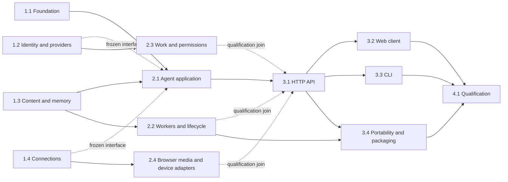

# Parallel implementation plan

Maximum four active agents including root. Root owns spec state, dependency installation, shared contracts, transport/application composition, web source and aggregate evidence. Each worker owns a disjoint file lane and its focused tests. A file cannot have two active writers. Root sends explicit ownership changes and settles API changes before consumers use them.

| Period | Root | Identity/work lane | Content/hosting lane | Integrations lane |
| --- | --- | --- | --- | --- |
| Initial independent work | 1.1 shared contracts/config/gates | 1.2 accounts/vault/providers/usage | 1.3 content/files/memory | 1.4 connections/network/webhooks |
| Domain completion | 2.1 agent application integration | 2.3 work/permissions | 2.2 worker/lifecycle | 2.4 real browser/media/MCP/device |
| Consumer delivery | 3.1 HTTP API, then 3.2 web | Narrow integration fixes/coverage | 3.4 portability/packaging | 3.3 CLI after HTTP contract |
| Final qualification | 4.1 full gate/docs | Assigned failures only | Assigned failures only | Assigned failures only |

Tasks in the first row rely on frozen contracts and existing sturgis-01 core APIs and can run together. Later tasks require focused verification of their declared dependencies. Root may study dependent integration before eligibility, but implementation/qualification follows the task graph. Helpers for remote-provider tests are explicitly fixtures; they do not replace real worker, database, browser or effect execution.

Each task handoff includes its public APIs, changed paths, focused tests, remaining limits and coverage evidence. Root snapshots with explicit task tags before `cg spec done`, then checks `cg spec trace`. Do not repeat full native builds or aggregate suites per worker. Dependencies install once; one owner builds the native worker. Final full qualification runs after integration; rerun only for an actual change or failure.

Application construction starts after foundation/content qualification against the frozen identity/network interfaces. Their independent qualification joins at 3.1 through tasks 2.3 and 2.4, which retain their 1.2/1.4 prerequisites. This avoids root idle time while preserving the complete HTTP integration gate.

The root HTTP lane may begin construction after 2.1 against frozen worker/work/connector APIs. Root must await focused qualification of 2.2, 2.3 and 2.4 before declaring 3.1 complete; tests cover their real composition. This separates construction scheduling from the final integration join.

CLI task 3.3 may construct against the frozen HTTP contract while task 3.1 completes security qualification; its qualification joins after 3.1.

Web task 3.2 may construct against the same frozen HTTP contract; qualification joins after task 3.1.

Portability task 3.4 constructs after private lifecycle qualification; its HTTP integration qualifies after task 3.1.

The Material 3 client join assigns separate owners to page interactions, runtime/recovery
state, archive interoperability, and root browser/style integration. User-journey
failures may require narrow core or control-plane corrections within task 3.2;
these paths and requirements are declared in its touches. Final task 4.1 repeats
the complete native/Python/browser qualification against the finished sources.

## Required documentation sites and parallel completion

Requirement 14 makes complete user and developer sites part of every implementation
closure. The workflow in `spec/workflow.kvx` applies beyond this corrective pass.
The actual sites live in `documentation/users` and `documentation/developers`; their
build, preview and maintenance instructions are in `documentation/README.md`.

| Lane | Exclusive ownership | Join evidence |
| --- | --- | --- |
| 5.1 Site framework and workflow | Astro configurations, shared theme, site assets, documentation gate and browser journey | Both production sites build and every local rendered route resolves |
| 5.2 User manuals | User pages, individual command cookbook and user coverage maps | Source-reviewed feature guidance, exact live command coverage and worked examples |
| 5.3 Source reference | Independent inventory, Python/Babel/compiler-AST extraction, reference rendering and parser tests | Every included file, qualified definition and numbered line is accounted for |
| 5.4 Developer manuals | Architecture, module and operating guides, request-field catalog and developer coverage map | Every core module, consumer source and frontend source has authored guidance |
| 6.1 Final join | Root integration and evidence only after all four lanes qualify | Complete docs gate, fresh receipt and Codify documentation closure |

The four writing/build lanes may run concurrently. Root alone changes shared spec
state, combines the manifests and starts the final join. Freeze authored sources
and manuals before final qualification: edits during that run reject the receipt.
Generated reference pages are reproducible outputs, not manually maintained claims.

Run `python3 scripts/docs_gate.py full` for the final join. It runs documentation
checker tests, derives current command names and parameters independently, checks
all command recipes and reviewed-source stamps, rebuilds and audits the source
reference, builds both sites, verifies rendered links and source anchors, validates
copyable snippets, executes the local mechanisms tutorial and exercises actual
browser search, navigation, themes, copy controls and mobile layouts. The browser
checks include automated accessibility rules and retained screenshots.

Review changed feature guidance before refreshing its source-review hashes. A
symbol list, Markdown landing page, link ledger or prior runtime qualification
cannot substitute for the two complete sites. Complete the configured Codify claims
only after the site gate passes, and use `python3 scripts/docs_gate.py close` so
source, content, generated output and evidence must still match at closure.
