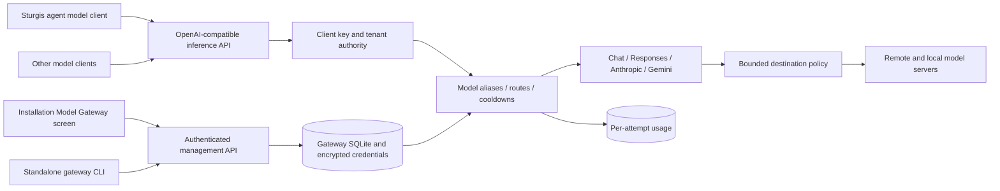

<!-- GENERATED by cg spec render from spec/ kvx — DO NOT EDIT. -->

Gateway-owned connections, encrypted credentials, catalogs, client keys, routing, cooldowns and usage; consumer-owned authentication integration; agents retain only a gateway client credential and model selection.

# Independent Model Gateway

The gateway is infrastructure. It starts with no agent, owns no conversations, invokes no tools and does not depend on the agent runtime. Sturgis, an SDK, or another application supplies a gateway key and a model/route name through the same HTTP contract.

Deployment modes are standalone ASGI/CLI and a composition mount in the consumer server. Both use the same service and store. Consumer authentication delegates a tenant identity; request bodies never choose it. The gateway package cannot import `agent` or `consumer`. Its local network policy is independent of agent tool grants.

The examined 9router reference is pinned at `17c4cc76877bd1755030a8414f8d0083f48dcccf`. See `.research/9router-gateway.md` for the actual provider, credential, discovery, translator and routing inventory. A provider logo or preset is not proof of authentication or inference support. API keys, anonymous endpoints and specialized OAuth/browser/subscription executors are distinct capabilities. Supported custom formats and an explicit compatible-gateway connection expose other installations without pretending to implement their sign-in flows.

Connections contain one upstream account and imported model metadata; multiple connections can target the same provider. Client model names are `connection-id/upstream-model-id`. Named routes refer to these names, never plaintext credentials. Priority fallback or round robin is bounded to explicitly listed destinations. After any response content/tool fragment is yielded, failures terminate that stream instead of silently replaying it elsewhere.

The agent binding is a consumer adapter: mint a restricted gateway client key, place that key in the private runtime vault, configure the gateway endpoint/model using catalog limits, probe, then select. Provider secrets stay in gateway storage. Existing direct-provider configurations remain readable and usable during migration.
